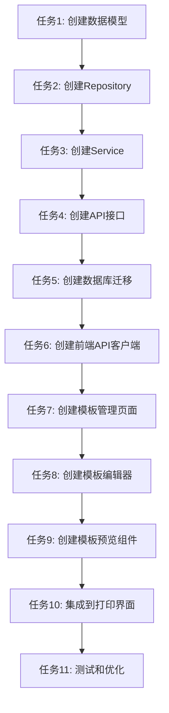

# 打印模板管理功能 - 任务拆分文档

## 任务依赖图

## 原子任务列表

### 任务1: 创建PrintTemplate数据模型

**输入契约**：
- 前置依赖：无
- 输入数据：无
- 环境依赖：PostgreSQL数据库

**输出契约**：
- 输出数据：`backend/app/models/print_template.py` 文件
- 交付物：PrintTemplate模型类，包含所有必需字段
- 验收标准：
  - 模型继承BaseModel
  - 包含name, type, template_config, is_default字段
  - 使用JSONB类型存储template_config
  - 支持软删除和多租户

**实现约束**：
- 技术栈：SQLAlchemy + PostgreSQL
- 接口规范：遵循现有模型规范
- 质量要求：代码注释完整，符合PEP8

**依赖关系**：
- 后置任务：任务2（Repository需要模型）

---

### 任务2: 创建PrintTemplateRepository

**输入契约**：
- 前置依赖：任务1完成
- 输入数据：PrintTemplate模型
- 环境依赖：数据库连接

**输出契约**：
- 输出数据：`backend/app/repositories/print_template_repository.py` 文件
- 交付物：PrintTemplateRepository类，包含CRUD方法
- 验收标准：
  - 实现create, update, delete, get_by_id, list_by_type方法
  - 支持多租户查询
  - 支持软删除
  - 支持按类型筛选

**实现约束**：
- 技术栈：SQLAlchemy ORM
- 接口规范：遵循现有Repository模式
- 质量要求：错误处理完善，日志记录

**依赖关系**：
- 前置任务：任务1
- 后置任务：任务3（Service需要Repository）

---

### 任务3: 创建PrintTemplateService

**输入契约**：
- 前置依赖：任务2完成
- 输入数据：PrintTemplateRepository
- 环境依赖：无

**输出契约**：
- 输出数据：`backend/app/services/print_template_service.py` 文件
- 交付物：PrintTemplateService类，包含业务逻辑方法
- 验收标准：
  - 实现create_template, update_template, delete_template方法
  - 实现get_template, list_templates方法
  - 实现render_template方法（模板渲染）
  - 实现set_default_template方法
  - 包含数据验证逻辑

**实现约束**：
- 技术栈：Python + FastAPI
- 接口规范：遵循现有Service模式
- 质量要求：业务逻辑清晰，异常处理完善

**依赖关系**：
- 前置任务：任务2
- 后置任务：任务4（API需要Service）

---

### 任务4: 创建API接口

**输入契约**：
- 前置依赖：任务3完成
- 输入数据：PrintTemplateService
- 环境依赖：FastAPI应用

**输出契约**：
- 输出数据：`backend/app/api/v1/print_templates.py` 文件
- 交付物：RESTful API端点
- 验收标准：
  - GET /print-templates (列表)
  - GET /print-templates/{id} (详情)
  - POST /print-templates (创建)
  - PUT /print-templates/{id} (更新)
  - DELETE /print-templates/{id} (删除)
  - GET /print-templates/{id}/preview (预览)
  - 所有接口支持认证和权限检查
  - 统一的响应格式

**实现约束**：
- 技术栈：FastAPI
- 接口规范：RESTful API设计
- 质量要求：参数验证，错误处理，日志记录

**依赖关系**：
- 前置任务：任务3
- 后置任务：任务5（需要API测试）

---

### 任务5: 创建数据库迁移脚本

**输入契约**：
- 前置依赖：任务1完成
- 输入数据：PrintTemplate模型定义
- 环境依赖：Alembic

**输出契约**：
- 输出数据：`backend/alembic/versions/xxx_add_print_templates_table.py` 文件
- 交付物：数据库迁移脚本
- 验收标准：
  - 创建print_templates表
  - 包含所有必需字段
  - 添加索引（tenant_id, type）
  - 支持upgrade和downgrade

**实现约束**：
- 技术栈：Alembic
- 接口规范：遵循现有迁移脚本格式
- 质量要求：迁移脚本可回滚

**依赖关系**：
- 前置任务：任务1
- 后置任务：任务6（前端需要数据库表）

---

### 任务6: 创建前端API客户端

**输入契约**：
- 前置依赖：任务4完成
- 输入数据：API接口定义
- 环境依赖：前端API工具

**输出契约**：
- 输出数据：`frontend/js/api.js` 文件更新
- 交付物：PrintTemplateAPI对象
- 验收标准：
  - getList方法（获取列表）
  - getDetail方法（获取详情）
  - create方法（创建）
  - update方法（更新）
  - delete方法（删除）
  - preview方法（预览）
  - 所有方法支持错误处理

**实现约束**：
- 技术栈：原生JavaScript
- 接口规范：遵循现有API客户端模式
- 质量要求：错误处理完善

**依赖关系**：
- 前置任务：任务4
- 后置任务：任务7（前端页面需要API）

---

### 任务7: 创建模板管理页面

**输入契约**：
- 前置依赖：任务6完成
- 输入数据：PrintTemplateAPI
- 环境依赖：前端组件库

**输出契约**：
- 输出数据：`frontend/views/system/print-templates.html` 文件
- 交付物：模板管理页面
- 验收标准：
  - 模板列表展示
  - 搜索和筛选功能
  - 新增、编辑、删除按钮
  - 设为默认功能
  - 响应式设计

**实现约束**：
- 技术栈：HTML + CSS + JavaScript + Bootstrap 5
- 接口规范：遵循现有页面模式
- 质量要求：UI友好，交互流畅

**依赖关系**：
- 前置任务：任务6
- 后置任务：任务8（编辑器需要管理页面）

---

### 任务8: 创建模板编辑器

**输入契约**：
- 前置依赖：任务7完成
- 输入数据：模板配置JSON
- 环境依赖：SortableJS库

**输出契约**：
- 输出数据：模板编辑器组件（在管理页面中）
- 交付物：拖拽式模板编辑器
- 验收标准：
  - 字段列表（可拖拽源）
  - 画布区域（拖拽目标）
  - 属性面板（编辑字段属性）
  - 支持字段拖拽排序
  - 支持字段删除
  - 支持字段属性编辑

**实现约束**：
- 技术栈：SortableJS + 原生JavaScript
- 接口规范：遵循现有组件模式
- 质量要求：拖拽流畅，交互友好

**依赖关系**：
- 前置任务：任务7
- 后置任务：任务9（预览需要编辑器）

---

### 任务9: 创建模板预览组件

**输入契约**：
- 前置依赖：任务8完成
- 输入数据：模板配置JSON + 模拟数据
- 环境依赖：模板渲染引擎

**输出契约**：
- 输出数据：模板预览组件（在编辑器中）
- 交付物：实时预览功能
- 验收标准：
  - 实时渲染模板
  - 使用模拟数据预览
  - 支持打印样式预览
  - 响应式预览

**实现约束**：
- 技术栈：原生JavaScript模板引擎
- 接口规范：遵循现有组件模式
- 质量要求：预览准确，性能良好

**依赖关系**：
- 前置任务：任务8
- 后置任务：任务10（打印集成需要预览）

---

### 任务10: 集成到现有打印界面

**输入契约**：
- 前置依赖：任务9完成
- 输入数据：现有打印页面 + 模板选择功能
- 环境依赖：打印页面

**输出契约**：
- 输出数据：更新现有打印页面
- 交付物：打印模板选择功能
- 验收标准：
  - 账单打印页面添加模板选择
  - 处方打印页面添加模板选择
  - 病历打印页面添加模板选择
  - 使用选中模板渲染打印内容
  - 支持默认模板

**实现约束**：
- 技术栈：现有打印页面技术栈
- 接口规范：遵循现有页面模式
- 质量要求：不影响现有功能

**依赖关系**：
- 前置任务：任务9
- 后置任务：任务11（测试需要完整功能）

---

### 任务11: 测试和优化

**输入契约**：
- 前置依赖：任务10完成
- 输入数据：完整功能
- 环境依赖：测试环境

**输出契约**：
- 输出数据：测试报告
- 交付物：功能测试、性能优化
- 验收标准：
  - 所有功能正常工作
  - 无语法错误和lint错误
  - 性能满足要求
  - 用户体验良好

**实现约束**：
- 技术栈：测试工具
- 接口规范：测试规范
- 质量要求：测试覆盖完整

**依赖关系**：
- 前置任务：任务10
- 后置任务：无

---

## 并行任务

以下任务可以并行执行：
- 任务5（数据库迁移）和任务6（前端API客户端）可以并行
- 任务7（管理页面）和任务8（编辑器）可以部分并行

## 复杂度评估

| 任务 | 复杂度 | 预估时间 |
|------|--------|----------|
| 任务1: 数据模型 | 低 | 30分钟 |
| 任务2: Repository | 低 | 1小时 |
| 任务3: Service | 中 | 2小时 |
| 任务4: API接口 | 中 | 2小时 |
| 任务5: 数据库迁移 | 低 | 30分钟 |
| 任务6: API客户端 | 低 | 1小时 |
| 任务7: 管理页面 | 中 | 2小时 |
| 任务8: 模板编辑器 | 高 | 4小时 |
| 任务9: 预览组件 | 中 | 2小时 |
| 任务10: 打印集成 | 中 | 2小时 |
| 任务11: 测试优化 | 中 | 2小时 |

**总预估时间**：约19小时

