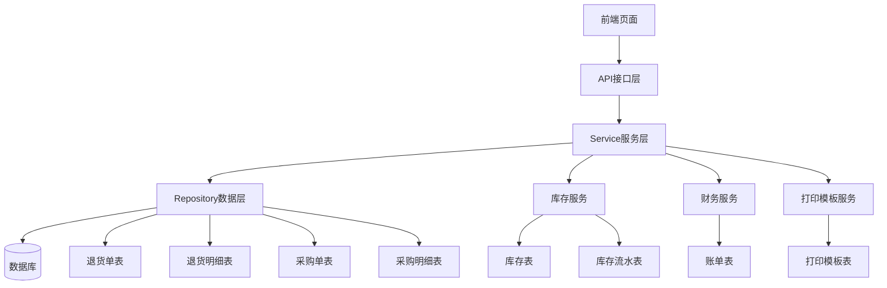
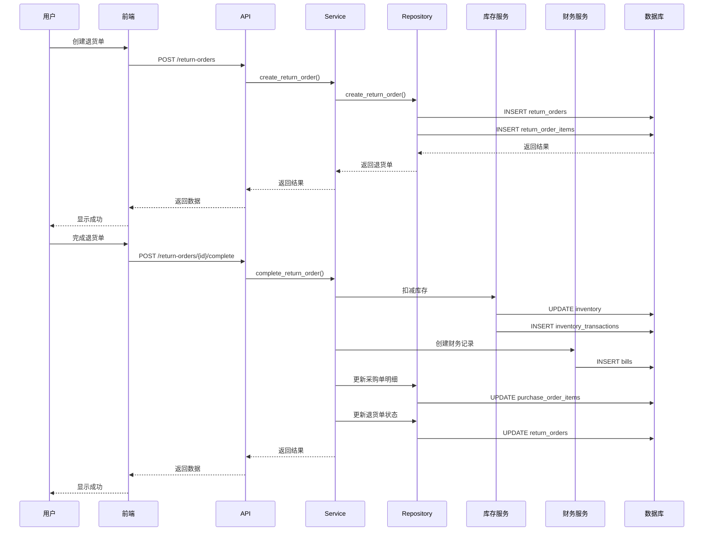

# 退货功能 - 设计文档

## 一、整体架构



## 二、数据模型设计

### 2.1 退货单表（return_orders）

```python
class ReturnOrder(BaseModel):
    __tablename__ = "return_orders"
    
    return_no: 退货单号（唯一）
    purchase_order_id: 采购单ID（外键）
    return_date: 退货日期
    total_amount: 总金额
    status: 状态（draft/approved/completed/cancelled）
    remark: 备注
    
    approved_by: 审核人ID
    approved_at: 审核时间
    completed_by: 执行人ID
    completed_at: 执行时间
    
    # 关系
    purchase_order: 关联采购单
    items: 关联退货明细列表
```

### 2.2 退货明细表（return_order_items）

```python
class ReturnOrderItem(BaseModel):
    __tablename__ = "return_order_items"
    
    return_order_id: 退货单ID（外键）
    purchase_order_item_id: 采购明细ID（外键）
    drug_id: 药品ID（外键）
    quantity: 退货数量
    unit_price: 单价
    total_amount: 总金额
    batch_no: 批次号
    expiry_date: 有效期
    
    # 关系
    return_order: 关联退货单
    purchase_order_item: 关联采购明细
```

## 三、模块设计

### 3.1 Repository层（数据访问层）

#### ReturnOrderRepository
- `generate_return_no(tenant_id)` - 生成退货单号
- `create_return_order(order_data, tenant_id)` - 创建退货单
- `get_return_order_by_id(order_id, tenant_id)` - 获取退货单
- `get_return_orders(tenant_id, skip, limit, filters)` - 获取退货单列表
- `update_return_order(order_id, tenant_id, order_data)` - 更新退货单
- `approve_return_order(order_id, tenant_id, approver_id)` - 审核退货单
- `complete_return_order(order_id, tenant_id, completer_id)` - 完成退货单
- `cancel_return_order(order_id, tenant_id)` - 取消退货单
- `delete_return_order(order_id, tenant_id)` - 删除退货单

### 3.2 Service层（业务逻辑层）

#### ReturnOrderService
- `create_return_order(order_data, tenant_id, creator_id)` - 创建退货单
  - 验证采购单状态
  - 验证退货数量
  - 计算总金额
  - 创建退货单和明细
  
- `get_return_order(order_id, tenant_id)` - 获取退货单详情
  
- `list_return_orders(tenant_id, filters)` - 获取退货单列表
  
- `update_return_order(order_id, tenant_id, order_data, updater_id)` - 更新退货单
  - 只能更新草稿状态的退货单
  - 验证退货数量
  
- `approve_return_order(order_id, tenant_id, approver_id)` - 审核退货单
  - 验证退货单状态
  - 更新状态为approved
  
- `complete_return_order(order_id, tenant_id, completer_id)` - 完成退货单
  - 验证退货单状态（必须是approved）
  - 更新库存（扣减）
  - 创建库存流水
  - 更新采购单明细的已入库数量
  - 创建财务记录
  - 更新退货单状态为completed
  
- `cancel_return_order(order_id, tenant_id)` - 取消退货单
  - 只能取消草稿或已审核状态的退货单
  
- `get_returnable_purchase_order(purchase_order_id, tenant_id)` - 获取可退货的采购单信息
  - 验证采购单状态
  - 计算每个明细的可退货数量

### 3.3 API层（接口层）

#### 路由设计
- `GET /api/v1/inventory/return-orders` - 获取退货单列表
- `GET /api/v1/inventory/return-orders/{id}` - 获取退货单详情
- `POST /api/v1/inventory/return-orders` - 创建退货单
- `PUT /api/v1/inventory/return-orders/{id}` - 更新退货单
- `POST /api/v1/inventory/return-orders/{id}/approve` - 审核退货单
- `POST /api/v1/inventory/return-orders/{id}/complete` - 完成退货单
- `POST /api/v1/inventory/return-orders/{id}/cancel` - 取消退货单
- `DELETE /api/v1/inventory/return-orders/{id}` - 删除退货单
- `GET /api/v1/inventory/purchase-orders/{id}/returnable` - 获取可退货的采购单信息

## 四、数据流向图



## 五、异常处理策略

### 5.1 业务异常
- `NotFoundException` - 资源不存在
- `BusinessException` - 业务规则违反（如退货数量超限、状态不正确等）

### 5.2 数据验证
- 采购单状态验证
- 退货数量验证
- 退货单状态验证
- 数据完整性验证

### 5.3 事务处理
- 完成退货单时使用数据库事务
- 确保库存、财务、退货单数据的一致性

## 六、接口契约定义

### 6.1 创建退货单请求
```json
{
  "purchase_order_id": "uuid",
  "return_date": "2025-01-01",
  "items": [
    {
      "purchase_order_item_id": "uuid",
      "quantity": 10,
      "batch_no": "BATCH001",
      "expiry_date": "2025-12-31"
    }
  ],
  "remark": "退货备注"
}
```

### 6.2 退货单响应
```json
{
  "id": "uuid",
  "return_no": "RO202501010001",
  "purchase_order_id": "uuid",
  "purchase_order_no": "PO202501010001",
  "return_date": "2025-01-01",
  "total_amount": 1000.00,
  "status": "draft",
  "items": [
    {
      "id": "uuid",
      "drug_id": "uuid",
      "drug_name": "药品名称",
      "quantity": 10,
      "unit_price": 100.00,
      "total_amount": 1000.00,
      "batch_no": "BATCH001",
      "expiry_date": "2025-12-31"
    }
  ],
  "remark": "退货备注"
}
```

## 七、前端页面设计

### 7.1 退货单列表页面
- 路径：`/views/inventory/return-orders.html`
- 功能：
  - 列表展示（退货单号、采购单号、退货日期、总金额、状态）
  - 搜索和筛选（退货单号、采购单号、状态、日期范围）
  - 操作按钮（查看、编辑、审核、完成、取消、删除、打印）

### 7.2 创建退货单弹窗
- 选择采购单（下拉选择，只显示已入库的采购单）
- 显示采购单明细（药品名称、已入库数量、单价）
- 选择退货药品和数量（支持全部退货快捷操作）
- 填写备注

### 7.3 打印功能
- 使用打印模板系统
- 支持选择打印模板
- 实时预览
- 打印按钮

