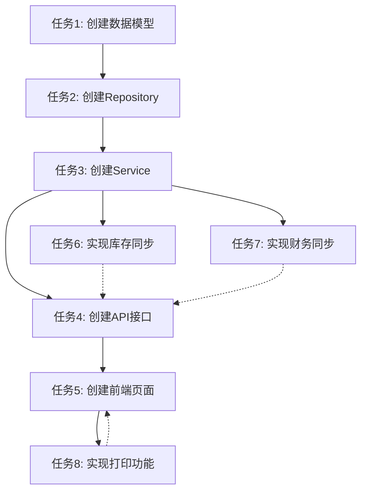

# 退货功能 - 任务拆分文档

## 一、任务依赖图

## 二、原子任务列表

### 任务1: 创建数据模型
**输入契约**：
- 前置依赖：无
- 输入数据：无
- 环境依赖：数据库连接

**输出契约**：
- 输出数据：ReturnOrder和ReturnOrderItem模型类
- 交付物：
  - `backend/app/models/inventory.py` - 添加退货单模型
  - `backend/alembic/versions/xxx_add_return_orders.py` - 数据库迁移脚本
- 验收标准：
  - 模型类定义正确
  - 数据库表创建成功
  - 字段类型和约束正确

**实现约束**：
- 继承BaseModel
- 使用UUID类型
- 添加必要的索引
- 添加关系定义

**依赖关系**：
- 后置任务：任务2

---

### 任务2: 创建Repository
**输入契约**：
- 前置依赖：任务1完成
- 输入数据：数据库会话
- 环境依赖：数据库连接

**输出契约**：
- 输出数据：ReturnOrderRepository类
- 交付物：
  - `backend/app/repositories/inventory_repository.py` - 添加ReturnOrderRepository类
- 验收标准：
  - 所有CRUD方法实现
  - 退货单号生成逻辑正确
  - 查询方法正确

**实现约束**：
- 遵循现有Repository模式
- 使用软删除
- 多租户隔离
- 异常处理

**依赖关系**：
- 前置任务：任务1
- 后置任务：任务3

---

### 任务3: 创建Service
**输入契约**：
- 前置依赖：任务2完成
- 输入数据：业务数据字典
- 环境依赖：数据库连接、库存服务、财务服务

**输出契约**：
- 输出数据：ReturnOrderService类
- 交付物：
  - `backend/app/services/inventory_service.py` - 添加ReturnOrderService类
- 验收标准：
  - 所有业务方法实现
  - 业务规则验证正确
  - 异常处理正确

**实现约束**：
- 遵循现有Service模式
- 业务逻辑验证
- 事务处理
- 日志记录

**依赖关系**：
- 前置任务：任务2
- 后置任务：任务4、任务6、任务7

---

### 任务4: 创建API接口
**输入契约**：
- 前置依赖：任务3完成
- 输入数据：HTTP请求
- 环境依赖：FastAPI框架

**输出契约**：
- 输出数据：API路由和请求/响应模型
- 交付物：
  - `backend/app/api/v1/inventory.py` - 添加退货单API路由
- 验收标准：
  - 所有API端点实现
  - 请求/响应模型正确
  - 错误处理正确
  - API文档完整

**实现约束**：
- 遵循现有API模式
- 使用Pydantic模型
- 多租户隔离
- 权限验证

**依赖关系**：
- 前置任务：任务3
- 后置任务：任务5

---

### 任务5: 创建前端页面
**输入契约**：
- 前置依赖：任务4完成
- 输入数据：API响应数据
- 环境依赖：浏览器、SPA框架

**输出契约**：
- 输出数据：前端页面和JavaScript代码
- 交付物：
  - `frontend/views/inventory/return-orders.html` - 退货单列表页面
  - `frontend/js/api.js` - 添加退货单API调用
- 验收标准：
  - 页面功能完整
  - 交互正常
  - 错误处理正确
  - 符合SPA模式

**实现约束**：
- 遵循现有前端模式
- 使用Bootstrap 5
- SPA路由集成
- 响应式设计

**依赖关系**：
- 前置任务：任务4
- 后置任务：任务8

---

### 任务6: 实现库存同步
**输入契约**：
- 前置依赖：任务3完成
- 输入数据：退货单数据
- 环境依赖：库存服务、数据库

**输出契约**：
- 输出数据：库存更新和流水记录
- 交付物：
  - `backend/app/services/inventory_service.py` - 在complete_return_order中实现库存同步
- 验收标准：
  - 库存正确扣减
  - 流水记录正确创建
  - 事务处理正确

**实现约束**：
- 使用现有库存服务
- 事务处理
- 异常回滚

**依赖关系**：
- 前置任务：任务3
- 并行任务：任务7

---

### 任务7: 实现财务同步
**输入契约**：
- 前置依赖：任务3完成
- 输入数据：退货单数据
- 环境依赖：财务服务、数据库

**输出契约**：
- 输出数据：财务记录（Bill）
- 交付物：
  - `backend/app/services/inventory_service.py` - 在complete_return_order中实现财务同步
- 验收标准：
  - 财务记录正确创建
  - 金额正确
  - 关联正确

**实现约束**：
- 使用现有财务服务
- 事务处理
- 异常回滚

**依赖关系**：
- 前置任务：任务3
- 并行任务：任务6

---

### 任务8: 实现打印功能
**输入契约**：
- 前置依赖：任务5完成
- 输入数据：退货单数据
- 环境依赖：打印模板服务

**输出契约**：
- 输出数据：打印模板和打印页面
- 交付物：
  - 打印模板类型：purchase_return
  - 前端打印功能集成
- 验收标准：
  - 打印模板可以创建
  - 打印功能正常
  - 打印内容正确

**实现约束**：
- 使用现有打印模板系统
- 支持模板选择
- 实时预览

**依赖关系**：
- 前置任务：任务5

