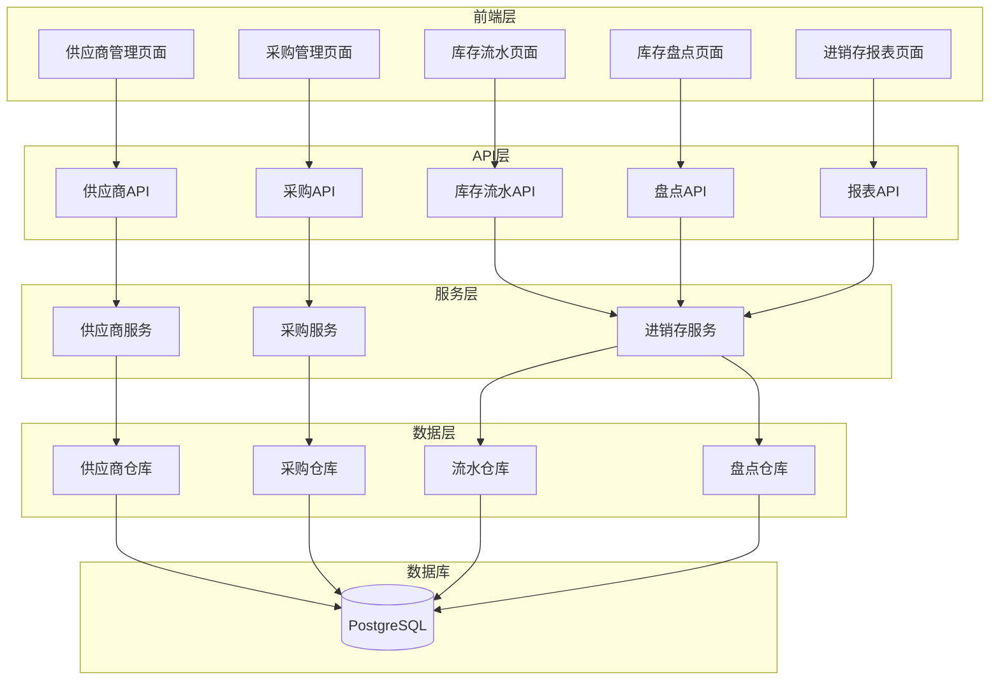

# 进销存模块设计文档

## 一、系统架构

### 1.1 模块架构图



## 二、数据模型设计

### 2.1 供应商模型（Supplier）

```python
class Supplier(BaseModel):
    __tablename__ = "suppliers"
    
    name: 供应商名称
    code: 供应商编码
    contact_name: 联系人
    contact_phone: 联系电话
    contact_email: 联系邮箱
    address: 地址
    category: 供应商分类
    status: 状态（active/inactive）
    remark: 备注
```

### 2.2 采购单模型（PurchaseOrder）

```python
class PurchaseOrder(BaseModel):
    __tablename__ = "purchase_orders"
    
    order_no: 采购单号
    supplier_id: 供应商ID
    order_date: 采购日期
    expected_date: 预计到货日期
    total_amount: 总金额
    status: 状态（draft/approved/received/cancelled）
    remark: 备注
    approved_by: 审核人
    approved_at: 审核时间
    received_by: 入库人
    received_at: 入库时间
```

### 2.3 采购明细模型（PurchaseOrderItem）

```python
class PurchaseOrderItem(BaseModel):
    __tablename__ = "purchase_order_items"
    
    purchase_order_id: 采购单ID
    drug_id: 药品ID
    quantity: 数量
    unit_price: 单价
    total_amount: 总金额
    received_quantity: 已入库数量
    batch_no: 批次号
    expiry_date: 有效期
```

### 2.4 库存流水模型（InventoryTransaction）

```python
class InventoryTransaction(BaseModel):
    __tablename__ = "inventory_transactions"
    
    drug_id: 药品ID
    transaction_type: 交易类型（purchase/sale/adjust/check）
    reference_id: 关联ID
    reference_type: 关联类型
    quantity: 数量（正数入库，负数出库）
    unit_price: 单价
    total_amount: 总金额
    before_quantity: 变动前库存
    after_quantity: 变动后库存
    operator_id: 操作人
    transaction_date: 交易日期
    remark: 备注
```

### 2.5 库存盘点模型（InventoryCheck）

```python
class InventoryCheck(BaseModel):
    __tablename__ = "inventory_checks"
    
    check_no: 盘点单号
    check_date: 盘点日期
    status: 状态（draft/completed）
    operator_id: 操作人
    remark: 备注
```

### 2.6 盘点明细模型（InventoryCheckItem）

```python
class InventoryCheckItem(BaseModel):
    __tablename__ = "inventory_check_items"
    
    inventory_check_id: 盘点单ID
    drug_id: 药品ID
    book_quantity: 账面数量
    actual_quantity: 实际数量
    difference: 差异数量
    unit_price: 单价
    difference_amount: 差异金额
    remark: 备注
```

## 三、接口设计

### 3.1 供应商管理接口

| 方法 | 路径 | 说明 |
|------|------|------|
| GET | /api/v1/inventory/suppliers | 获取供应商列表 |
| GET | /api/v1/inventory/suppliers/{id} | 获取供应商详情 |
| POST | /api/v1/inventory/suppliers | 创建供应商 |
| PUT | /api/v1/inventory/suppliers/{id} | 更新供应商 |
| DELETE | /api/v1/inventory/suppliers/{id} | 删除供应商 |

### 3.2 采购管理接口

| 方法 | 路径 | 说明 |
|------|------|------|
| GET | /api/v1/inventory/purchase-orders | 获取采购单列表 |
| GET | /api/v1/inventory/purchase-orders/{id} | 获取采购单详情 |
| POST | /api/v1/inventory/purchase-orders | 创建采购单 |
| PUT | /api/v1/inventory/purchase-orders/{id} | 更新采购单 |
| POST | /api/v1/inventory/purchase-orders/{id}/approve | 审核采购单 |
| POST | /api/v1/inventory/purchase-orders/{id}/receive | 入库 |
| DELETE | /api/v1/inventory/purchase-orders/{id} | 删除采购单 |

### 3.3 库存流水接口

| 方法 | 路径 | 说明 |
|------|------|------|
| GET | /api/v1/inventory/transactions | 获取库存流水列表 |
| GET | /api/v1/inventory/transactions/{id} | 获取流水详情 |

### 3.4 库存盘点接口

| 方法 | 路径 | 说明 |
|------|------|------|
| GET | /api/v1/inventory/checks | 获取盘点单列表 |
| GET | /api/v1/inventory/checks/{id} | 获取盘点单详情 |
| POST | /api/v1/inventory/checks | 创建盘点单 |
| POST | /api/v1/inventory/checks/{id}/complete | 完成盘点 |
| DELETE | /api/v1/inventory/checks/{id} | 删除盘点单 |

### 3.5 进销存报表接口

| 方法 | 路径 | 说明 |
|------|------|------|
| GET | /api/v1/inventory/reports/summary | 进销存汇总 |
| GET | /api/v1/inventory/reports/turnover | 库存周转率 |
| GET | /api/v1/inventory/reports/sales | 销售统计 |
| GET | /api/v1/inventory/reports/purchases | 采购统计 |

## 四、数据流向

### 4.1 采购流程
```
创建采购单 → 添加采购明细 → 审核采购单 → 入库 → 更新库存 → 记录库存流水
```

### 4.2 销售流程（发药）
```
发药 → 更新库存 → 记录库存流水（类型：sale）
```

### 4.3 盘点流程
```
创建盘点单 → 录入盘点数据 → 完成盘点 → 计算差异 → 调整库存 → 记录库存流水
```

## 五、异常处理

### 5.1 采购异常
- 采购单已审核，不能修改
- 采购单已入库，不能删除
- 入库数量不能超过采购数量

### 5.2 库存异常
- 出库数量不能超过当前库存
- 盘点差异需要审批（可选）

---

**文档版本**: v1.0  
**创建时间**: 2024-12-19

