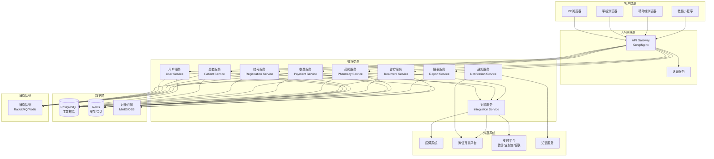
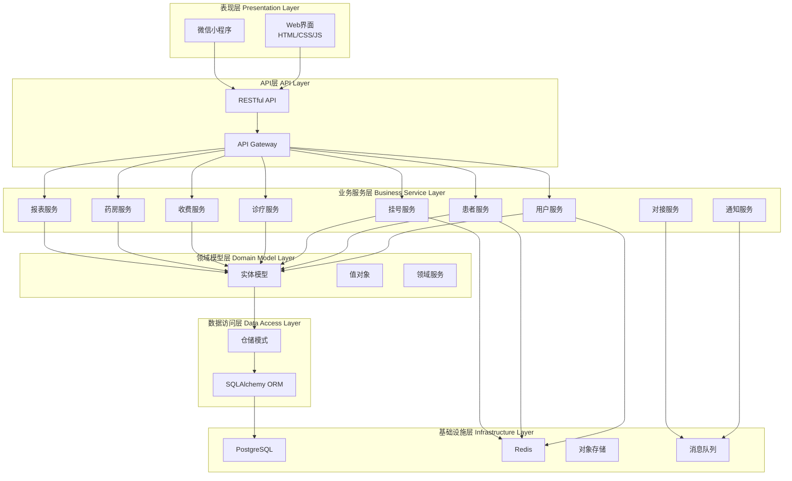
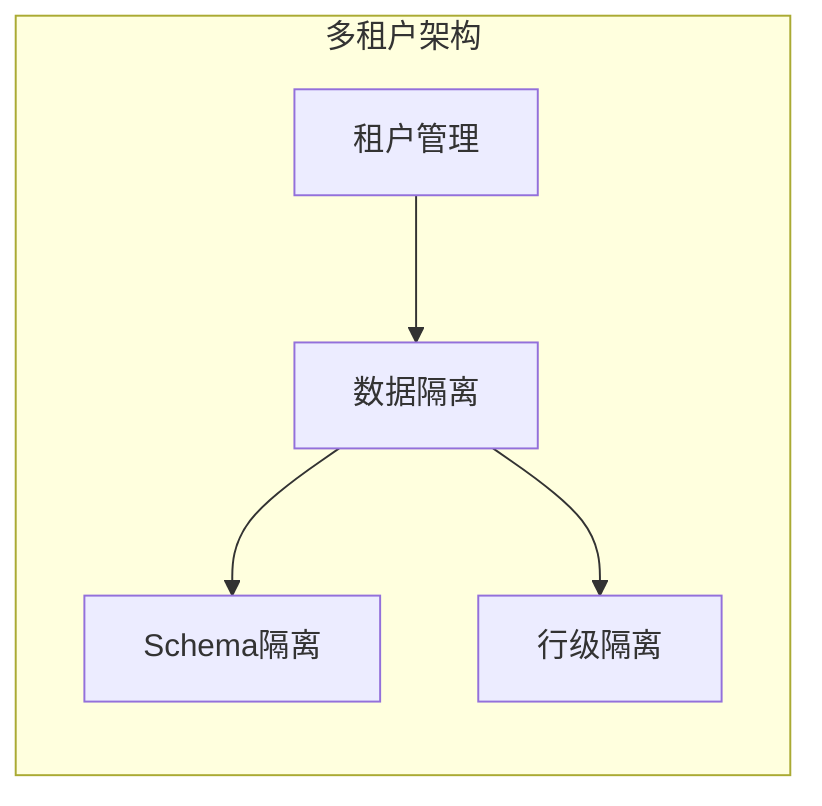
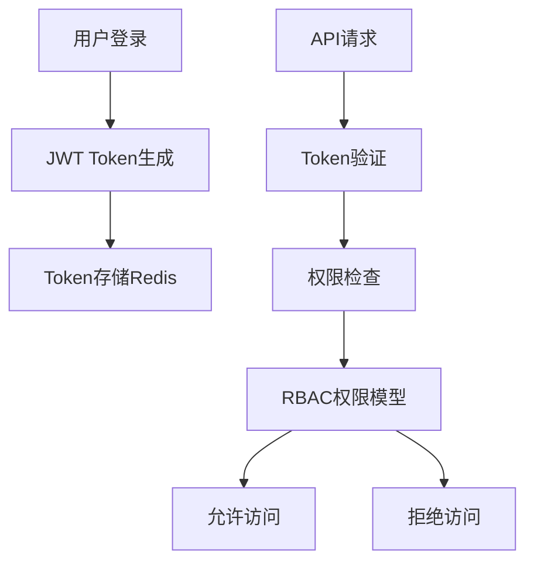
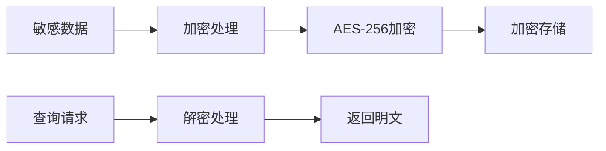
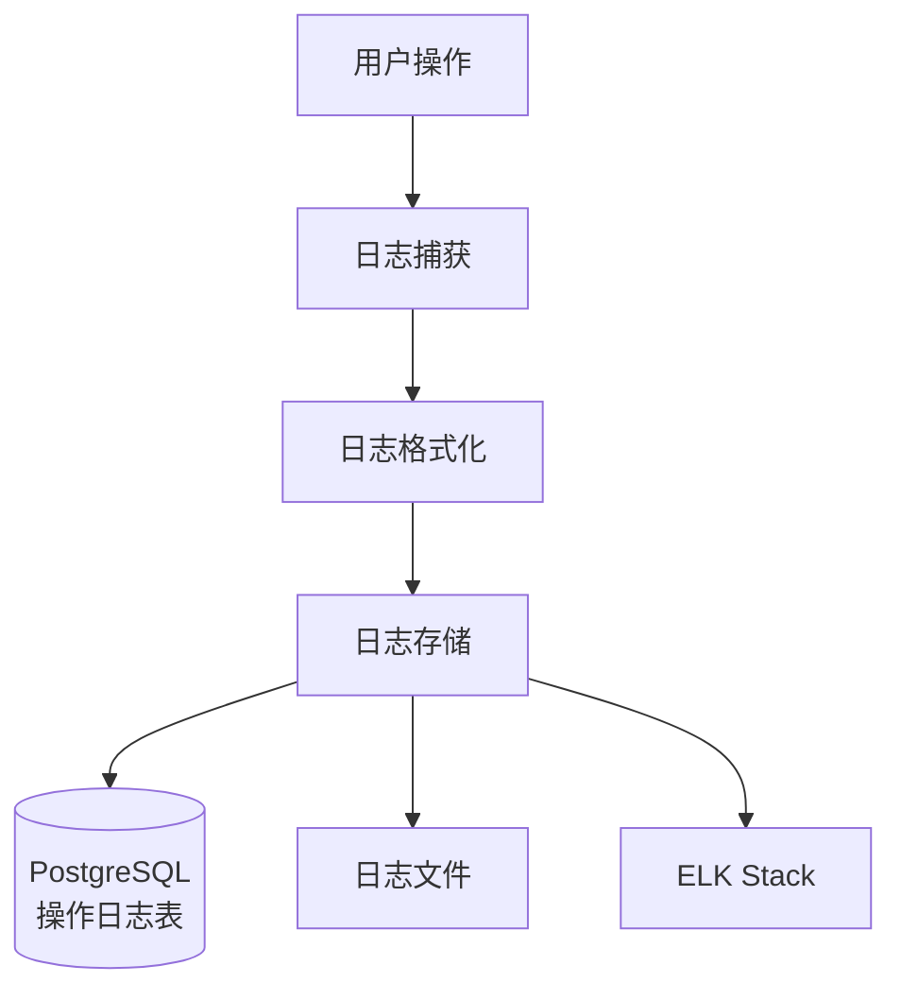
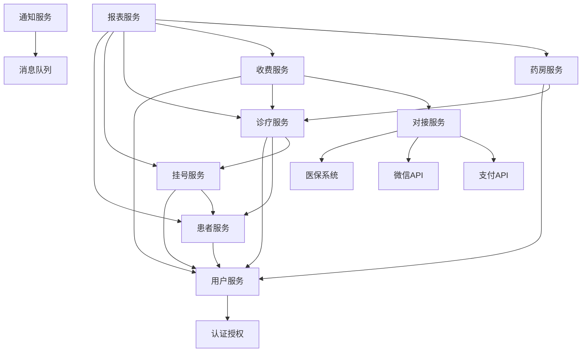
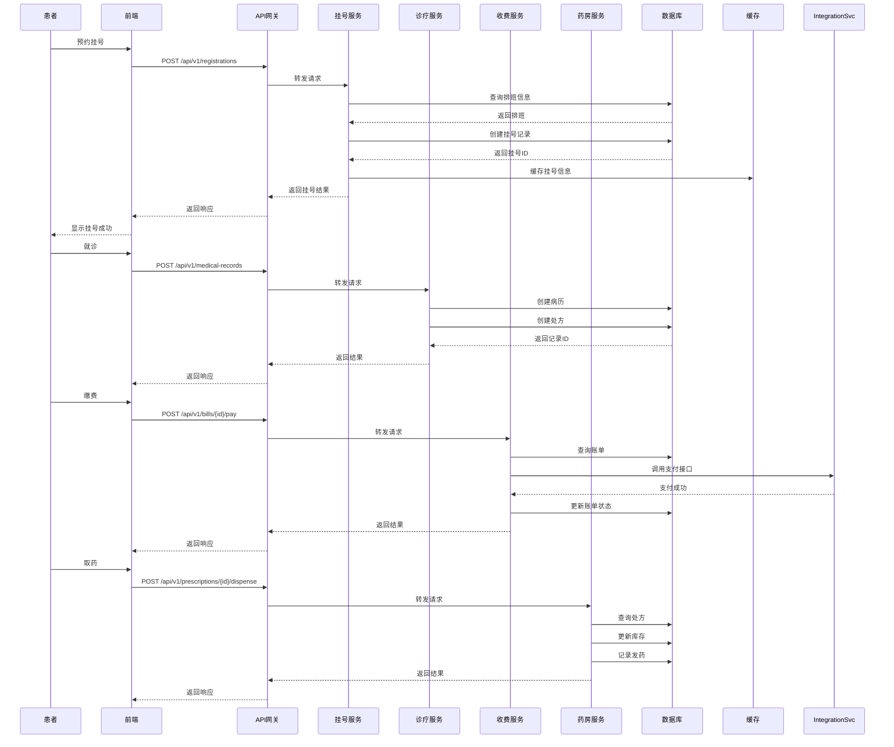
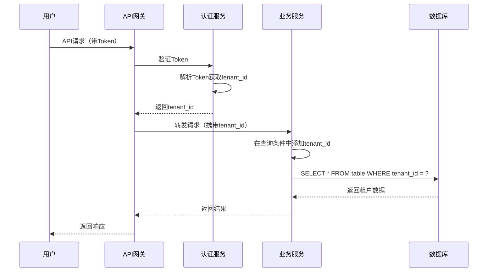
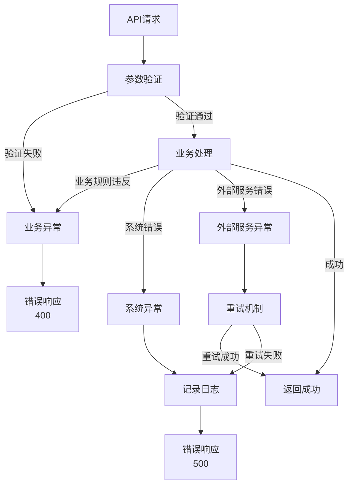

# DESIGN_门诊诊所管理系统

## 一、整体架构设计

### 1.1 架构图



### 1.2 架构说明

#### 1.2.1 客户端层
- **PC浏览器**: 主要工作终端，完整功能
- **平板浏览器**: 移动办公，响应式界面
- **移动端浏览器**: 移动查询和简单操作
- **微信小程序**: 患者端预约、查询等功能

#### 1.2.2 API网关层
- **API Gateway**: 统一入口，路由转发，负载均衡
- **认证服务**: JWT Token验证，权限校验

#### 1.2.3 微服务层
- **用户服务**: 用户管理、认证、授权、权限管理
- **患者服务**: 患者档案管理、就诊历史
- **挂号服务**: 预约挂号、排班管理
- **诊疗服务**: 病历、诊断、处方管理
- **收费服务**: 费用计算、收费结算、退费
- **药房服务**: 药品管理、库存管理、进销存
- **报表服务**: 数据统计、报表生成
- **通知服务**: 短信、微信通知
- **对接服务**: 医保、支付、微信对接

#### 1.2.4 数据层
- **PostgreSQL**: 主数据库，存储业务数据
- **Redis**: 缓存、会话存储、分布式锁
- **对象存储**: 文件存储（病历附件、图片等）

#### 1.2.5 消息队列
- **RabbitMQ/Redis**: 异步任务处理、服务间通信

## 二、分层设计

### 2.1 系统分层架构



### 2.2 分层职责

#### 2.2.1 表现层
- **职责**: 用户界面展示、用户交互
- **技术**: HTML5、CSS3、JavaScript (ES6+)
- **特点**: 响应式设计，支持多终端

#### 2.2.2 API层
- **职责**: API路由、参数验证、响应格式化
- **技术**: FastAPI/Flask
- **特点**: RESTful API设计，统一错误处理

#### 2.2.3 业务服务层
- **职责**: 业务逻辑处理、业务流程编排
- **技术**: Python业务逻辑代码
- **特点**: 微服务独立部署，服务间通过API或消息队列通信

#### 2.2.4 领域模型层
- **职责**: 领域实体、业务规则、领域服务
- **技术**: Python类、领域驱动设计(DDD)
- **特点**: 业务逻辑封装，与基础设施解耦

#### 2.2.5 数据访问层
- **职责**: 数据持久化、数据查询
- **技术**: SQLAlchemy ORM、Repository模式
- **特点**: 数据访问抽象，支持多租户数据隔离

#### 2.2.6 基础设施层
- **职责**: 数据库、缓存、存储、消息队列
- **技术**: PostgreSQL、Redis、对象存储、RabbitMQ
- **特点**: 基础设施服务，支持高可用

## 三、核心组件设计

### 3.1 多租户组件



#### 3.1.1 租户管理
- **租户标识**: 每个租户有唯一tenant_id
- **租户信息**: 机构名称、配置信息、订阅功能
- **租户隔离**: 数据完全隔离，互不可见

#### 3.1.2 数据隔离策略
- **方案**: 行级隔离（Row-level Security）
- **实现**: 所有业务表包含tenant_id字段
- **查询**: 自动在WHERE条件中添加tenant_id过滤

### 3.2 认证授权组件



#### 3.2.1 认证机制
- **JWT Token**: 无状态认证，包含用户ID、租户ID、角色信息
- **Token存储**: Redis存储，支持刷新和撤销
- **Token过期**: Access Token短期（1小时），Refresh Token长期（7天）

#### 3.2.2 授权机制
- **RBAC模型**: 角色-权限-资源三级权限控制
- **细粒度权限**: 功能权限 + 数据权限
- **权限缓存**: Redis缓存用户权限，提升性能

### 3.3 数据加密组件



#### 3.3.1 加密策略
- **传输加密**: HTTPS/TLS 1.3
- **存储加密**: 
  - 敏感字段AES-256加密（患者姓名、身份证、电话）
  - 数据库连接加密
  - 备份数据加密

#### 3.3.2 加密字段
- 患者姓名
- 身份证号
- 手机号码
- 银行卡号
- 其他敏感信息

### 3.4 日志审计组件



#### 3.4.1 日志类型
- **操作日志**: 用户操作记录（增删改查）
- **系统日志**: 系统运行日志
- **错误日志**: 异常和错误记录
- **审计日志**: 敏感操作审计（如删除患者、修改费用）

#### 3.4.2 日志内容
- 操作时间
- 操作用户
- 操作类型
- 操作对象
- 操作前数据
- 操作后数据
- IP地址
- 设备信息

## 四、模块依赖关系

### 4.1 服务依赖图



### 4.2 模块说明

#### 4.2.1 基础模块（无业务依赖）
- **用户服务**: 用户管理、认证、授权
- **认证授权**: JWT认证、权限验证

#### 4.2.2 核心业务模块
- **患者服务**: 依赖用户服务
- **挂号服务**: 依赖用户服务、患者服务
- **诊疗服务**: 依赖用户服务、患者服务、挂号服务
- **收费服务**: 依赖用户服务、诊疗服务、对接服务
- **药房服务**: 依赖用户服务、诊疗服务

#### 4.2.3 支撑模块
- **报表服务**: 依赖所有业务模块
- **通知服务**: 通过消息队列异步处理
- **对接服务**: 被收费服务、挂号服务调用

## 五、接口契约定义

### 5.1 API设计规范

#### 5.1.1 RESTful API规范
- **URL规范**: `/api/v1/{resource}/{id}/{sub-resource}`
- **HTTP方法**: GET（查询）、POST（创建）、PUT（更新）、DELETE（删除）
- **状态码**: 200（成功）、201（创建成功）、400（参数错误）、401（未授权）、403（无权限）、404（不存在）、500（服务器错误）

#### 5.1.2 请求格式
```json
{
  "headers": {
    "Authorization": "Bearer {token}",
    "Content-Type": "application/json",
    "X-Tenant-Id": "{tenant_id}"
  },
  "body": {
    // 请求数据
  }
}
```

#### 5.1.3 响应格式
```json
{
  "code": 200,
  "message": "success",
  "data": {
    // 响应数据
  },
  "timestamp": "2024-12-19T10:00:00Z"
}
```

### 5.2 核心接口定义

#### 5.2.1 用户服务接口
```
POST   /api/v1/auth/login          # 用户登录
POST   /api/v1/auth/logout         # 用户登出
POST   /api/v1/auth/refresh        # 刷新Token
GET    /api/v1/users               # 获取用户列表
POST   /api/v1/users               # 创建用户
GET    /api/v1/users/{id}          # 获取用户详情
PUT    /api/v1/users/{id}          # 更新用户
DELETE /api/v1/users/{id}          # 删除用户
GET    /api/v1/roles               # 获取角色列表
POST   /api/v1/permissions         # 获取权限列表
```

#### 5.2.2 患者服务接口
```
GET    /api/v1/patients            # 获取患者列表
POST   /api/v1/patients            # 创建患者
GET    /api/v1/patients/{id}       # 获取患者详情
PUT    /api/v1/patients/{id}       # 更新患者
DELETE /api/v1/patients/{id}      # 删除患者（软删除）
GET    /api/v1/patients/{id}/visits # 获取就诊历史
GET    /api/v1/patients/search    # 搜索患者
```

#### 5.2.3 挂号服务接口
```
GET    /api/v1/registrations       # 获取挂号列表
POST   /api/v1/registrations       # 创建挂号
GET    /api/v1/registrations/{id}  # 获取挂号详情
PUT    /api/v1/registrations/{id}  # 更新挂号
POST   /api/v1/registrations/{id}/cancel # 取消挂号
GET    /api/v1/schedules           # 获取排班列表
POST   /api/v1/schedules           # 创建排班
```

#### 5.2.4 诊疗服务接口
```
GET    /api/v1/medical-records     # 获取病历列表
POST   /api/v1/medical-records     # 创建病历
GET    /api/v1/medical-records/{id} # 获取病历详情
PUT    /api/v1/medical-records/{id} # 更新病历
GET    /api/v1/prescriptions       # 获取处方列表
POST   /api/v1/prescriptions       # 创建处方
GET    /api/v1/prescriptions/{id}  # 获取处方详情
```

#### 5.2.5 收费服务接口
```
GET    /api/v1/bills               # 获取账单列表
POST   /api/v1/bills               # 创建账单
GET    /api/v1/bills/{id}          # 获取账单详情
POST   /api/v1/bills/{id}/pay     # 支付账单
POST   /api/v1/bills/{id}/refund  # 退费
GET    /api/v1/payments            # 获取支付记录
```

#### 5.2.6 药房服务接口
```
GET    /api/v1/drugs               # 获取药品列表
POST   /api/v1/drugs               # 创建药品
GET    /api/v1/drugs/{id}          # 获取药品详情
PUT    /api/v1/drugs/{id}          # 更新药品
GET    /api/v1/inventory            # 获取库存列表
POST   /api/v1/inventory/in        # 入库
POST   /api/v1/inventory/out       # 出库
GET    /api/v1/inventory/warning   # 库存预警
```

#### 5.2.7 报表服务接口
```
GET    /api/v1/reports/revenue     # 收入报表
GET    /api/v1/reports/visits      # 就诊量报表
GET    /api/v1/reports/drugs       # 药品销售报表
GET    /api/v1/reports/patients   # 患者统计报表
```

### 5.3 消息队列接口

#### 5.3.1 通知消息
```json
{
  "type": "notification",
  "event": "appointment_reminder",
  "data": {
    "patient_id": "123",
    "appointment_time": "2024-12-20 10:00:00",
    "channel": ["sms", "wechat"]
  }
}
```

#### 5.3.2 业务事件
```json
{
  "type": "business_event",
  "event": "patient_registered",
  "data": {
    "patient_id": "123",
    "registration_id": "456",
    "tenant_id": "789"
  }
}
```

## 六、数据流向图

### 6.1 患者就诊流程数据流



### 6.2 多租户数据隔离流程



## 七、异常处理策略

### 7.1 异常分类

#### 7.1.1 业务异常
- **类型**: 业务规则违反、数据验证失败
- **处理**: 返回明确的错误信息，HTTP状态码400
- **示例**: 患者不存在、库存不足、余额不足

#### 7.1.2 系统异常
- **类型**: 系统错误、数据库错误、外部服务错误
- **处理**: 记录错误日志，返回通用错误信息，HTTP状态码500
- **示例**: 数据库连接失败、外部API调用失败

#### 7.1.3 认证授权异常
- **类型**: Token无效、权限不足
- **处理**: 返回认证/授权错误，HTTP状态码401/403
- **示例**: Token过期、无访问权限

### 7.2 异常处理流程



### 7.3 异常处理实现

#### 7.3.1 统一异常处理
```python
# 异常基类
class BaseException(Exception):
    code: int
    message: str

# 业务异常
class BusinessException(BaseException):
    code = 400
    message = "业务处理失败"

# 系统异常
class SystemException(BaseException):
    code = 500
    message = "系统错误"

# 全局异常处理器
@app.exception_handler(BaseException)
async def exception_handler(request, exc):
    return JSONResponse(
        status_code=exc.code,
        content={
            "code": exc.code,
            "message": exc.message,
            "timestamp": datetime.now().isoformat()
        }
    )
```

#### 7.3.2 重试机制
- **外部服务调用**: 实现指数退避重试
- **数据库操作**: 连接池自动重连
- **消息队列**: 失败消息进入死信队列

#### 7.3.3 降级策略
- **缓存降级**: 外部服务失败时使用缓存数据
- **功能降级**: 非核心功能失败不影响主流程
- **限流降级**: 高并发时限制请求速率

## 八、数据库设计原则

### 8.1 多租户设计
- **策略**: 行级隔离（Row-level Security）
- **实现**: 所有业务表包含`tenant_id`字段
- **索引**: `tenant_id` + 业务字段建立联合索引

### 8.2 表设计规范
- **命名**: 小写+下划线，如`patient_info`
- **主键**: 统一使用UUID或雪花算法ID
- **时间戳**: 统一包含`created_at`、`updated_at`
- **软删除**: 重要数据使用`deleted_at`软删除

### 8.3 数据加密
- **敏感字段**: 使用AES-256加密存储
- **加密字段**: 姓名、身份证、电话等
- **查询优化**: 加密字段不支持模糊查询，需建立索引映射表

## 九、安全设计

### 9.1 传输安全
- **HTTPS**: 强制使用HTTPS
- **TLS版本**: TLS 1.3
- **证书管理**: 定期更新SSL证书

### 9.2 存储安全
- **数据加密**: 敏感数据AES-256加密
- **密码加密**: 使用bcrypt哈希
- **密钥管理**: 密钥存储在密钥管理服务（KMS）

### 9.3 访问安全
- **认证**: JWT Token认证
- **授权**: RBAC细粒度权限控制
- **审计**: 完整操作日志记录
- **限流**: API限流防止暴力攻击

## 十、性能优化策略

### 10.1 缓存策略
- **热点数据**: Redis缓存（患者信息、药品信息）
- **缓存更新**: 写时更新、定时刷新
- **缓存失效**: TTL过期、主动失效

### 10.2 数据库优化
- **索引优化**: 关键查询字段建立索引
- **查询优化**: 避免N+1查询，使用JOIN
- **分页优化**: 使用游标分页替代OFFSET

### 10.3 异步处理
- **耗时操作**: 报表生成、通知发送异步处理
- **消息队列**: 使用消息队列解耦服务
- **任务队列**: Celery处理后台任务

## 十一、部署架构

### 11.1 容器化部署
- **Docker**: 每个微服务独立容器
- **Docker Compose**: 开发环境一键启动
- **Kubernetes**: 生产环境容器编排

### 11.2 服务发现
- **Consul/etcd**: 服务注册与发现
- **健康检查**: 定期健康检查，自动剔除故障服务
- **负载均衡**: Nginx/Kong实现负载均衡

### 11.3 监控告警
- **监控**: Prometheus + Grafana
- **日志**: ELK Stack
- **告警**: 异常自动告警通知

## 十二、设计原则总结

### 12.1 微服务原则
- **单一职责**: 每个服务职责单一
- **独立部署**: 服务可独立部署和扩展
- **服务通信**: RESTful API + 消息队列

### 12.2 多租户原则
- **数据隔离**: 严格的数据隔离
- **资源共享**: 基础设施共享，降低成本
- **配置隔离**: 每个租户独立配置

### 12.3 安全原则
- **最小权限**: 最小权限原则
- **纵深防御**: 多层安全防护
- **审计追踪**: 完整操作审计

### 12.4 性能原则
- **缓存优先**: 合理使用缓存
- **异步处理**: 耗时操作异步化
- **数据库优化**: 索引和查询优化

## 十三、下一步行动

### 13.1 已完成
- ✅ 整体架构设计
- ✅ 分层设计
- ✅ 核心组件设计
- ✅ 接口契约定义
- ✅ 数据流向设计
- ✅ 异常处理策略

### 13.2 待完成
- ⏳ 详细数据库表结构设计
- ⏳ 详细API接口文档
- ⏳ 进入Atomize阶段（任务拆分）

