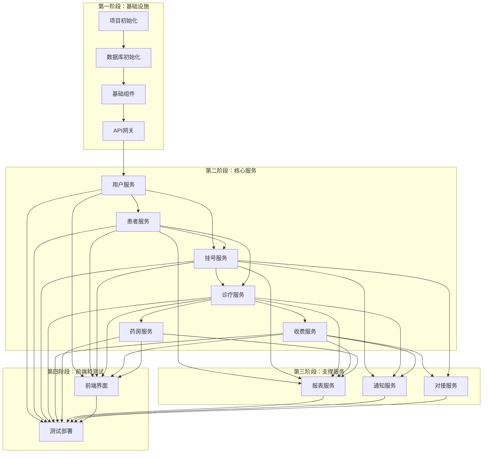

# TASK_门诊诊所管理系统

## 一、任务概览

本文档将项目拆分为原子任务，每个任务包含输入契约、输出契约、实现约束和依赖关系。

### 1.1 任务分类

任务按模块分为以下类别：
- **TASK_01_基础设施** - 项目基础设施、数据库、配置
- **TASK_02_用户服务** - 用户管理、认证、授权
- **TASK_03_患者服务** - 患者档案管理
- **TASK_04_挂号服务** - 挂号、预约、排班
- **TASK_05_诊疗服务** - 病历、诊断、处方
- **TASK_06_收费服务** - 收费、结算、支付
- **TASK_07_药房服务** - 药品、库存、进销存
- **TASK_08_报表服务** - 数据统计、报表生成
- **TASK_09_通知服务** - 短信、微信通知
- **TASK_10_对接服务** - 医保、支付、微信对接
- **TASK_11_前端界面** - Web前端、响应式设计
- **TASK_12_测试部署** - 测试、部署、文档

### 1.2 任务依赖图

### 1.3 任务执行顺序

#### 阶段1：基础设施（基础依赖）
1. TASK_01_基础设施.md 中的所有任务

#### 阶段2：核心服务（业务功能）
2. TASK_02_用户服务.md 中的所有任务
3. TASK_03_患者服务.md 中的所有任务
4. TASK_04_挂号服务.md 中的所有任务
5. TASK_05_诊疗服务.md 中的所有任务
6. TASK_06_收费服务.md 中的所有任务
7. TASK_07_药房服务.md 中的所有任务

#### 阶段3：支撑服务（辅助功能）
8. TASK_08_报表服务.md 中的所有任务
9. TASK_09_通知服务.md 中的所有任务
10. TASK_10_对接服务.md 中的所有任务

#### 阶段4：前端和测试（完整系统）
11. TASK_11_前端界面.md 中的所有任务
12. TASK_12_测试部署.md 中的所有任务

## 二、任务状态跟踪

### 2.1 任务状态定义
- **pending**: 待开始
- **in_progress**: 进行中
- **completed**: 已完成
- **blocked**: 阻塞中
- **cancelled**: 已取消

### 2.2 任务清单汇总

各模块详细任务请参考对应的子文档：
- [TASK_01_基础设施.md](./TASK_01_基础设施.md)
- [TASK_02_用户服务.md](./TASK_02_用户服务.md)
- [TASK_03_患者服务.md](./TASK_03_患者服务.md)
- [TASK_04_挂号服务.md](./TASK_04_挂号服务.md)
- [TASK_05_诊疗服务.md](./TASK_05_诊疗服务.md)
- [TASK_06_收费服务.md](./TASK_06_收费服务.md)
- [TASK_07_药房服务.md](./TASK_07_药房服务.md)
- [TASK_08_报表服务.md](./TASK_08_报表服务.md)
- [TASK_09_通知服务.md](./TASK_09_通知服务.md)
- [TASK_10_对接服务.md](./TASK_10_对接服务.md)
- [TASK_11_前端界面.md](./TASK_11_前端界面.md)
- [TASK_12_测试部署.md](./TASK_12_测试部署.md)

## 三、任务执行原则

### 3.1 执行顺序
- 严格按照依赖关系执行
- 同一阶段的任务可以并行执行（如果无依赖）
- 前置任务未完成，不得开始后续任务

### 3.2 验收标准
- 每个任务必须通过验收标准才能标记为完成
- 验收包括：功能测试、单元测试、代码审查、文档更新

### 3.3 质量要求
- 代码符合项目规范（PEP 8、ESLint）
- 单元测试覆盖率 > 80%
- 所有API接口有文档
- 关键功能有集成测试

## 四、任务更新记录

| 日期 | 更新内容 | 更新人 |
|------|---------|--------|
| 2024-12-19 | 创建任务拆分文档 | System |

