# DESIGN_v2.0 - 门诊诊所管理系统 v2.0 版本架构设计

## 一、整体架构设计

### 1.1 架构图

```mermaid
graph TB
    subgraph "客户端层"
        PC[PC浏览器]
        Tablet[平板浏览器]
        Mobile[移动端浏览器]
        WeChatMini[微信小程序<br/>患者端/医生端]
    end
    
    subgraph "API网关层"
        Gateway[API Gateway<br/>Kong/Nginx]
        Auth[认证服务<br/>JWT + RBAC]
        RateLimit[限流服务<br/>API限流]
    end
    
    subgraph "微服务层 - 核心业务"
        UserSvc[用户服务<br/>User Service]
        PatientSvc[患者服务<br/>Patient Service]
        RegSvc[挂号服务<br/>Registration Service]
        TreatSvc[诊疗服务<br/>Treatment Service]
        PaySvc[收费服务<br/>Payment Service]
        PharmacySvc[药房服务<br/>Pharmacy Service]
        ReportSvc[报表服务<br/>Report Service]
    end
    
    subgraph "微服务层 - 支撑服务"
        NotifySvc[通知服务<br/>Notification Service]
        IntegrationSvc[对接服务<br/>Integration Service]
        DashboardSvc[工作台服务<br/>Dashboard Service<br/>v2.0新增]
        SearchSvc[搜索服务<br/>Search Service<br/>v2.0新增]
        IntelligenceSvc[智能服务<br/>Intelligence Service<br/>v2.0新增]
    end
    
    subgraph "微服务层 - 监管合规服务 v2.0新增"
        MedicalInsuranceReg[医保监管服务<br/>Medical Insurance<br/>Regulatory Service]
        DrugReg[食药监监管服务<br/>Drug Regulatory<br/>Service]
        HealthReg[卫健委监管服务<br/>Health Regulatory<br/>Service]
        SecuritySvc[安全增强服务<br/>Security Service]
    end
    
    subgraph "数据层"
        PG[(PostgreSQL<br/>主数据库)]
        Redis[(Redis<br/>缓存/会话)]
        Storage[对象存储<br/>MinIO/OSS]
        Backup[备份存储<br/>Backup Storage<br/>v2.0新增]
    end
    
    subgraph "消息队列"
        MQ[消息队列<br/>RabbitMQ/Redis]
        TaskQueue[任务队列<br/>Celery<br/>v2.0增强]
    end
    
    subgraph "外部系统"
        MedicalInsurance[医保系统]
        DrugAdmin[食药监局系统]
        HealthAdmin[卫健委系统]
        WeChatAPI[微信开放平台]
        PaymentAPI[支付平台<br/>微信/支付宝/银联]
        SMSService[短信服务]
    end
    
    PC --> Gateway
    Tablet --> Gateway
    Mobile --> Gateway
    WeChatMini --> Gateway
    
    Gateway --> RateLimit
    Gateway --> Auth
    Gateway --> UserSvc
    Gateway --> PatientSvc
    Gateway --> RegSvc
    Gateway --> TreatSvc
    Gateway --> PaySvc
    Gateway --> PharmacySvc
    Gateway --> ReportSvc
    Gateway --> DashboardSvc
    Gateway --> SearchSvc
    Gateway --> IntelligenceSvc
    Gateway --> MedicalInsuranceReg
    Gateway --> DrugReg
    Gateway --> HealthReg
    
    UserSvc --> PG
    UserSvc --> Redis
    PatientSvc --> PG
    PatientSvc --> Redis
    RegSvc --> PG
    RegSvc --> Redis
    TreatSvc --> PG
    TreatSvc --> Redis
    PaySvc --> PG
    PaySvc --> Redis
    PharmacySvc --> PG
    PharmacySvc --> Redis
    ReportSvc --> PG
    ReportSvc --> Redis
    
    DashboardSvc --> PG
    DashboardSvc --> Redis
    SearchSvc --> PG
    SearchSvc --> Redis
    IntelligenceSvc --> PG
    IntelligenceSvc --> Redis
    
    MedicalInsuranceReg --> PG
    MedicalInsuranceReg --> Redis
    DrugReg --> PG
    DrugReg --> Redis
    HealthReg --> PG
    HealthReg --> Redis
    SecuritySvc --> PG
    SecuritySvc --> Redis
    SecuritySvc --> Backup
    
    NotifySvc --> MQ
    NotifySvc --> SMSService
    NotifySvc --> WeChatAPI
    
    IntegrationSvc --> MedicalInsurance
    IntegrationSvc --> WeChatAPI
    IntegrationSvc --> PaymentAPI
    
    MedicalInsuranceReg --> MedicalInsurance
    DrugReg --> DrugAdmin
    HealthReg --> HealthAdmin
    
    PaySvc --> IntegrationSvc
    RegSvc --> IntegrationSvc
    TreatSvc --> IntegrationSvc
    
    TreatSvc --> Storage
    PatientSvc --> Storage
    DashboardSvc --> Storage
    
    SecuritySvc --> MQ
    MedicalInsuranceReg --> MQ
    DrugReg --> MQ
    HealthReg --> MQ
    
    ReportSvc --> TaskQueue
    MedicalInsuranceReg --> TaskQueue
    DrugReg --> TaskQueue
    HealthReg --> TaskQueue
```

### 1.2 架构说明

#### 1.2.1 客户端层
- **PC浏览器**: 主要工作终端，完整功能，支持v2.0新增的工作台、数据可视化等功能
- **平板浏览器**: 移动办公，响应式界面，支持触摸操作优化
- **移动端浏览器**: 移动查询和简单操作，响应式设计优化
- **微信小程序**: v2.0新增，患者端（预约、查询、支付）和医生端（排班、开方、查询）

#### 1.2.2 API网关层
- **API Gateway**: 统一入口，路由转发，负载均衡
- **认证服务**: JWT Token验证，权限校验，v2.0增强细粒度权限控制
- **限流服务**: v2.0新增，API限流，防止接口滥用

#### 1.2.3 微服务层 - 核心业务（保持v1.0）
- **用户服务**: 用户管理、认证、授权、权限管理
- **患者服务**: 患者档案管理、就诊历史，v2.0增强照片、标签、分组、关系管理
- **挂号服务**: 预约挂号、排班管理，v2.0增强预约提醒、改期、黑名单、批量排班
- **诊疗服务**: 病历、诊断、处方管理，v2.0增强病历模板、语音输入、处方审核
- **收费服务**: 费用计算、收费结算、退费，v2.0增强多种支付方式、电子发票
- **药房服务**: 药品管理、库存管理、进销存，v2.0增强药品图片、条码、批次、采购
- **报表服务**: 数据统计、报表生成，v2.0增强数据可视化、趋势分析

#### 1.2.4 微服务层 - 支撑服务（v2.0新增/增强）
- **通知服务**: 短信、微信通知（保持v1.0）
- **对接服务**: 医保、支付、微信对接（保持v1.0）
- **工作台服务**: v2.0新增，快捷操作、数据可视化、待办提醒
- **搜索服务**: v2.0新增，高级搜索、搜索历史、自动补全
- **智能服务**: v2.0新增，智能推荐、数据分析

#### 1.2.5 微服务层 - 监管合规服务（v2.0新增）
- **医保监管服务**: 医保结算数据上报、违规监控、政策管理
- **食药监监管服务**: 药品追溯、处方管理、特殊药品监管、进销存数据上报
- **卫健委监管服务**: 医疗质量上报、传染病报告、医疗事故管理
- **安全增强服务**: 数据加密增强、访问控制增强、备份恢复、审计日志

#### 1.2.6 数据层
- **PostgreSQL**: 主数据库，存储业务数据，v2.0版本升级到15+
- **Redis**: 缓存、会话存储、分布式锁，v2.0版本升级到7+，增强缓存策略
- **对象存储**: 文件存储（病历附件、图片等），v2.0增强支持患者照片、药品图片
- **备份存储**: v2.0新增，定期数据备份存储

#### 1.2.7 消息队列
- **RabbitMQ/Redis**: 异步任务处理、服务间通信（保持v1.0）
- **任务队列**: v2.0增强，Celery任务队列，支持监管数据上报等异步任务

## 二、分层设计

### 2.1 系统分层架构

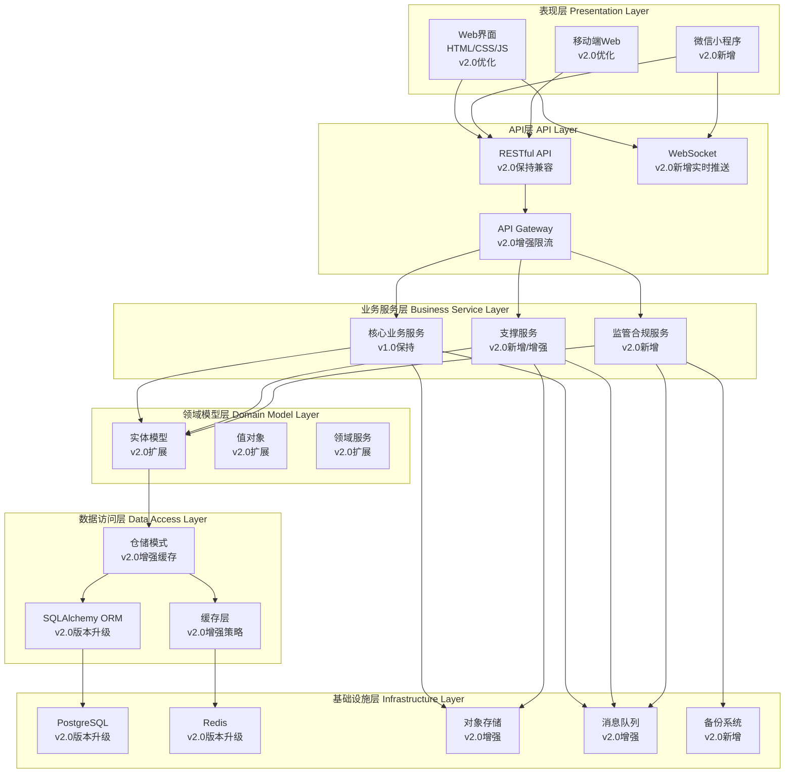

### 2.2 分层职责

#### 2.2.1 表现层
- **职责**: 用户界面展示、用户交互
- **技术**: HTML5、CSS3、JavaScript (ES6+)、微信小程序
- **v2.0增强**:
  - 工作台数据可视化（图表展示）
  - 表单自动保存
  - 高级搜索界面
  - 移动端响应式优化
  - 微信小程序界面

#### 2.2.2 API层
- **职责**: API路由、参数验证、响应格式化、限流
- **技术**: FastAPI（v2.0版本升级）
- **v2.0增强**:
  - API限流机制
  - WebSocket实时推送
  - 响应性能优化
  - 保持v1.0 API兼容性

#### 2.2.3 业务服务层
- **职责**: 业务逻辑处理、业务流程编排
- **技术**: Python业务逻辑代码（v2.0升级到Python 3.11+）
- **v2.0新增**:
  - 工作台服务
  - 搜索服务
  - 智能服务
  - 监管合规服务（医保、食药监、卫健委）
  - 安全增强服务

#### 2.2.4 领域模型层
- **职责**: 领域实体、业务规则、领域服务
- **技术**: Python类、领域驱动设计(DDD)
- **v2.0扩展**:
  - 监管合规领域模型
  - 智能推荐领域模型
  - 数据可视化领域模型

#### 2.2.5 数据访问层
- **职责**: 数据持久化、数据查询、缓存管理
- **技术**: SQLAlchemy ORM（v2.0版本升级）、Repository模式、Redis缓存
- **v2.0增强**:
  - 缓存策略优化
  - 查询性能优化
  - 数据加密增强

#### 2.2.6 基础设施层
- **职责**: 数据库、缓存、存储、消息队列、备份
- **技术**: PostgreSQL 15+、Redis 7+、对象存储、RabbitMQ、备份系统
- **v2.0增强**:
  - 数据库版本升级
  - 缓存版本升级
  - 新增备份系统

## 三、核心组件设计

### 3.1 多租户组件（保持v1.0）

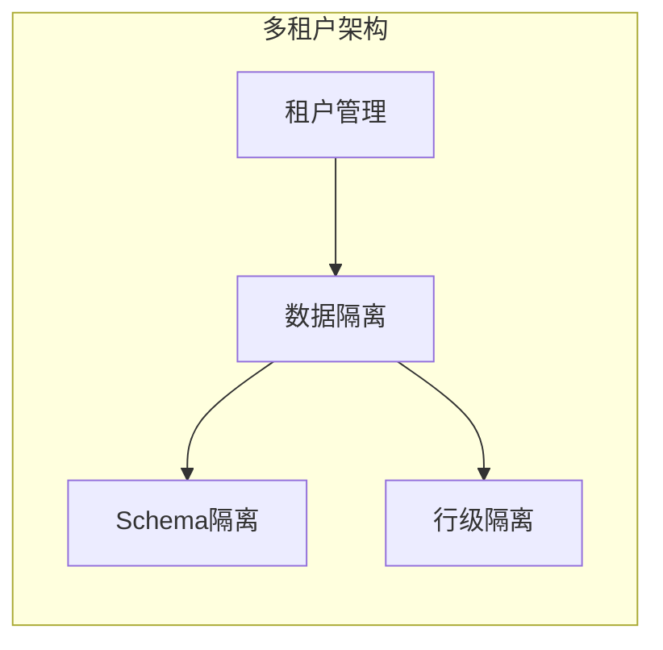

#### 3.1.1 租户管理
- **租户标识**: 每个租户有唯一tenant_id
- **租户信息**: 机构名称、配置信息、订阅功能
- **租户隔离**: 数据完全隔离，互不可见
- **v2.0增强**: 租户级别的监管合规配置

#### 3.1.2 数据隔离策略
- **方案**: 行级隔离（Row-level Security）
- **实现**: 所有业务表包含tenant_id字段
- **查询**: 自动在WHERE条件中添加tenant_id过滤
- **v2.0增强**: 监管数据也支持多租户隔离

### 3.2 认证授权组件（v2.0增强）

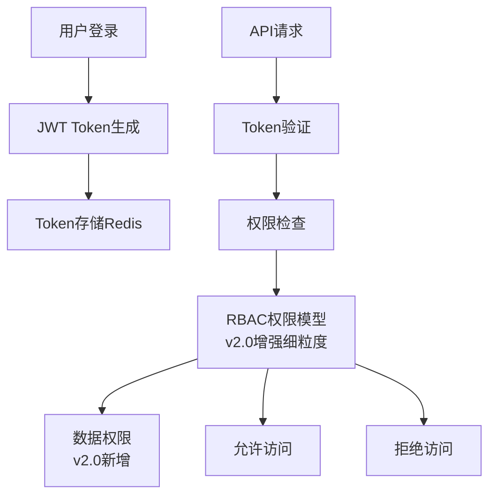

#### 3.2.1 认证机制
- **JWT Token**: 无状态认证，包含用户ID、租户ID、角色信息
- **Token存储**: Redis存储，支持刷新和撤销
- **Token过期**: Access Token短期（1小时），Refresh Token长期（7天）
- **v2.0增强**: 支持移动端Token、微信小程序Token

#### 3.2.2 授权机制
- **RBAC模型**: 角色-权限-资源三级权限控制
- **细粒度权限**: 功能权限 + 数据权限（v2.0新增）
- **权限缓存**: Redis缓存用户权限，提升性能
- **v2.0增强**: 
  - 数据级权限控制（如：医生只能查看自己的患者）
  - 监管数据访问权限控制
  - 操作审计权限

### 3.3 数据加密组件（v2.0增强）

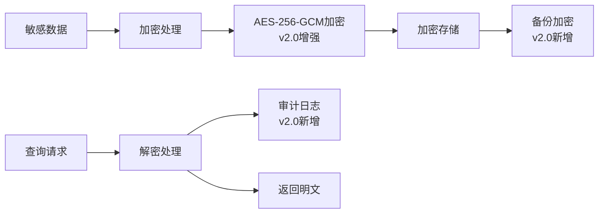

#### 3.3.1 加密策略
- **传输加密**: HTTPS/TLS 1.3（保持v1.0）
- **存储加密**: 
  - 敏感字段AES-256-GCM加密（患者姓名、身份证、电话等）
  - 数据库连接加密
  - 备份数据加密（v2.0新增）
- **v2.0增强**:
  - 监管数据加密传输
  - 监管数据加密存储
  - 密钥轮换机制

#### 3.3.2 加密字段
- 患者姓名
- 身份证号
- 手机号码
- 银行卡号
- 监管数据敏感字段（v2.0新增）
- 其他敏感信息

### 3.4 日志审计组件（v2.0增强）

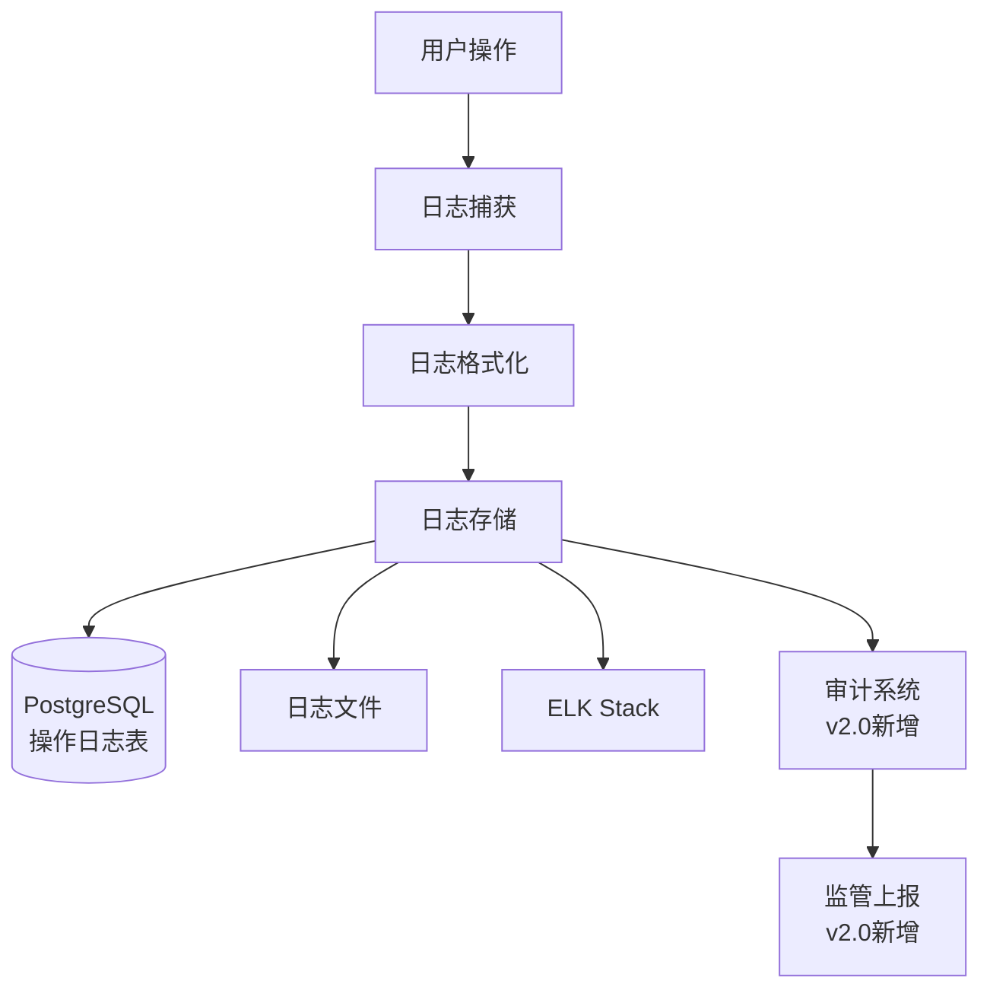

#### 3.4.1 日志类型
- **操作日志**: 用户操作记录（增删改查）
- **系统日志**: 系统运行日志
- **错误日志**: 异常和错误记录
- **审计日志**: 敏感操作审计（如：删除患者、修改费用）
- **监管日志**: v2.0新增，监管相关操作日志

#### 3.4.2 日志内容
- 操作时间
- 操作用户
- 操作类型
- 操作对象
- 操作前数据
- 操作后数据
- IP地址
- 设备信息
- 监管标识（v2.0新增）

### 3.5 监管合规组件（v2.0新增）

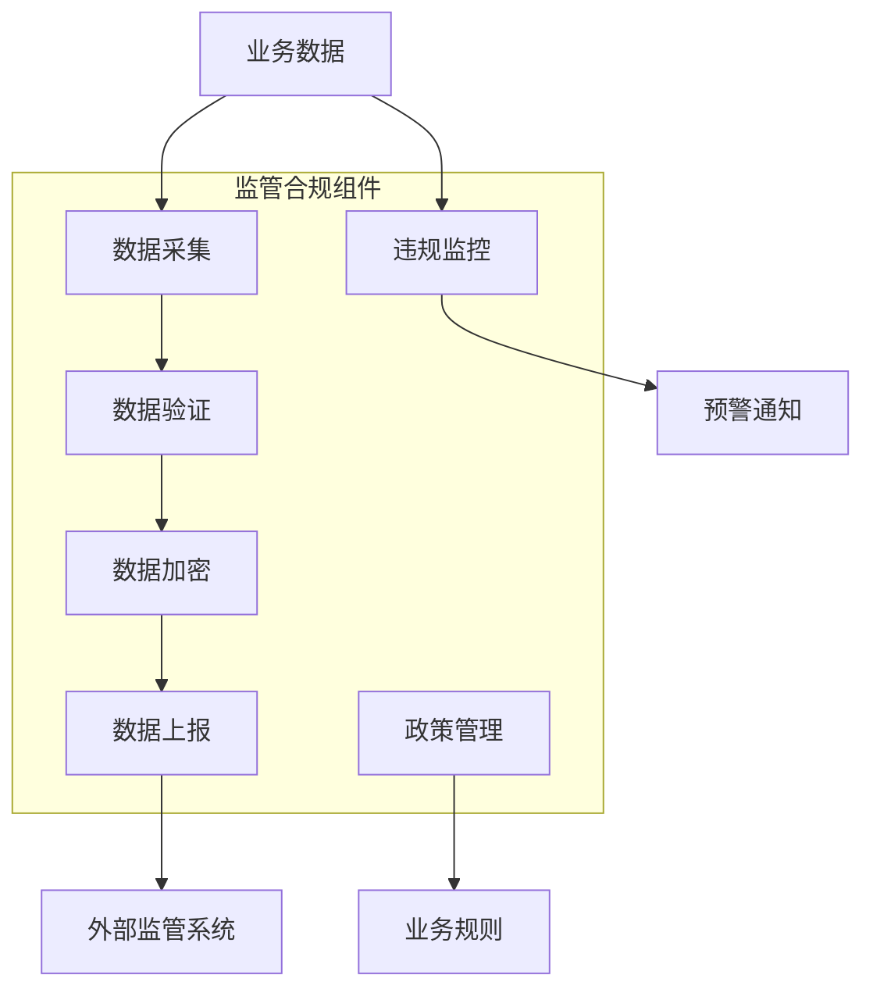

#### 3.5.1 医保监管组件
- **数据采集**: 医保结算数据采集
- **数据验证**: 医保数据格式验证
- **数据上报**: 医保数据定时/实时上报
- **违规监控**: 医保违规行为监控和预警
- **政策管理**: 医保政策配置和管理

#### 3.5.2 食药监监管组件
- **药品追溯**: 药品流向追踪管理
- **处方管理**: 特殊药品处方监管
- **数据上报**: 药品进销存数据上报
- **质量监控**: 药品质量监控

#### 3.5.3 卫健委监管组件
- **质量上报**: 医疗质量数据上报
- **传染病报告**: 传染病报告管理
- **事故管理**: 医疗事故管理
- **统计分析**: 医疗统计数据分析

### 3.6 性能优化组件（v2.0新增）

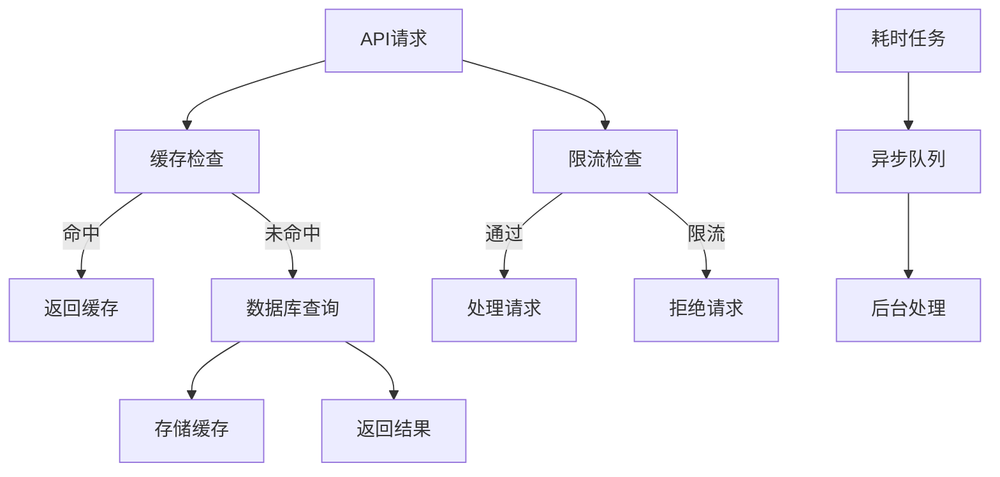

#### 3.6.1 缓存策略
- **热点数据缓存**: Redis缓存患者信息、药品信息等
- **查询结果缓存**: 复杂查询结果缓存
- **缓存更新**: 写时更新、定时刷新
- **缓存失效**: TTL过期、主动失效

#### 3.6.2 限流策略
- **API限流**: 基于IP、用户、接口的限流
- **限流算法**: 令牌桶算法
- **限流配置**: 可配置的限流规则

#### 3.6.3 异步处理
- **耗时操作**: 报表生成、监管数据上报异步处理
- **任务队列**: Celery任务队列，支持异步任务处理
- **任务类型**: 
  - 报表生成任务
  - 监管数据上报任务
  - 数据备份任务
  - 批量处理任务
- **任务监控**: 任务状态监控、失败重试机制

## 四、模块依赖关系

### 4.1 服务依赖图（v2.0增强版）

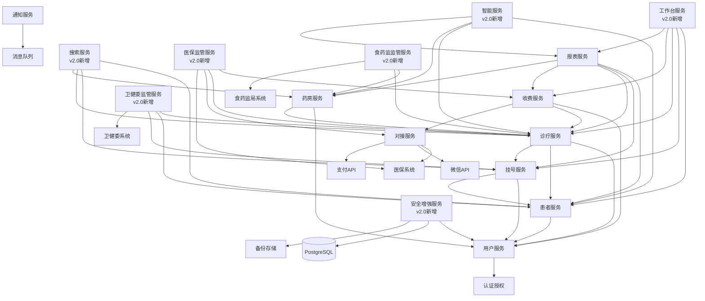

### 4.2 模块说明

#### 4.2.1 基础模块（无业务依赖）
- **用户服务**: 用户管理、认证、授权
- **认证授权**: JWT认证、权限验证
- **安全增强服务**: v2.0新增，数据加密、备份恢复、审计日志

#### 4.2.2 核心业务模块（保持v1.0）
- **患者服务**: 依赖用户服务
- **挂号服务**: 依赖用户服务、患者服务
- **诊疗服务**: 依赖用户服务、患者服务、挂号服务
- **收费服务**: 依赖用户服务、诊疗服务、对接服务
- **药房服务**: 依赖用户服务、诊疗服务

#### 4.2.3 支撑模块（v2.0新增/增强）
- **报表服务**: 依赖所有业务模块
- **工作台服务**: v2.0新增，依赖多个业务模块
- **搜索服务**: v2.0新增，依赖多个业务模块
- **智能服务**: v2.0新增，依赖多个业务模块
- **通知服务**: 通过消息队列异步处理
- **对接服务**: 被收费服务、挂号服务调用

#### 4.2.4 监管合规模块（v2.0新增）
- **医保监管服务**: 依赖收费服务、诊疗服务、对接服务
- **食药监监管服务**: 依赖药房服务、诊疗服务
- **卫健委监管服务**: 依赖诊疗服务、患者服务、挂号服务

## 五、接口契约定义

### 5.1 API设计规范

#### 5.1.1 RESTful API规范（保持v1.0兼容）
- **URL规范**: `/api/v1/{resource}/{id}/{sub-resource}` 或 `/api/v2/{resource}`（v2.0新接口）
- **HTTP方法**: GET（查询）、POST（创建）、PUT（更新）、DELETE（删除）、PATCH（部分更新）
- **状态码**: 200（成功）、201（创建成功）、400（参数错误）、401（未授权）、403（无权限）、404（不存在）、429（限流）、500（服务器错误）
- **版本兼容**: v2.0保持v1.0 API兼容，新增接口使用v2版本

#### 5.1.2 请求格式
```json
{
  "headers": {
    "Authorization": "Bearer {token}",
    "Content-Type": "application/json",
    "X-Tenant-Id": "{tenant_id}",
    "X-Client-Type": "web|mobile|miniprogram"
  },
  "body": {
    // 请求数据
  }
}
```

#### 5.1.3 响应格式
```json
{
  "code": 200,
  "message": "success",
  "data": {
    // 响应数据
  },
  "timestamp": "2024-12-19T10:00:00Z",
  "request_id": "uuid"
}
```

### 5.2 核心接口定义（保持v1.0）

#### 5.2.1 用户服务接口（保持v1.0）
```
POST   /api/v1/auth/login          # 用户登录
POST   /api/v1/auth/logout         # 用户登出
POST   /api/v1/auth/refresh        # 刷新Token
GET    /api/v1/users               # 获取用户列表
POST   /api/v1/users               # 创建用户
GET    /api/v1/users/{id}          # 获取用户详情
PUT    /api/v1/users/{id}          # 更新用户
DELETE /api/v1/users/{id}          # 删除用户
GET    /api/v1/roles               # 获取角色列表
POST   /api/v1/permissions         # 获取权限列表
```

#### 5.2.2 患者服务接口（v2.0增强）
```
GET    /api/v1/patients            # 获取患者列表
POST   /api/v1/patients            # 创建患者
GET    /api/v1/patients/{id}       # 获取患者详情
PUT    /api/v1/patients/{id}       # 更新患者
DELETE /api/v1/patients/{id}      # 删除患者（软删除）
GET    /api/v1/patients/{id}/visits # 获取就诊历史
GET    /api/v1/patients/search    # 搜索患者
POST   /api/v2/patients/{id}/photos # v2.0新增：上传患者照片
GET    /api/v2/patients/{id}/tags  # v2.0新增：获取患者标签
POST   /api/v2/patients/{id}/tags  # v2.0新增：添加患者标签
GET    /api/v2/patients/groups    # v2.0新增：获取患者分组
POST   /api/v2/patients/{id}/relations # v2.0新增：添加患者关系
```

#### 5.2.3 挂号服务接口（v2.0增强）
```
GET    /api/v1/registrations       # 获取挂号列表
POST   /api/v1/registrations       # 创建挂号
GET    /api/v1/registrations/{id}  # 获取挂号详情
PUT    /api/v1/registrations/{id}  # 更新挂号
POST   /api/v1/registrations/{id}/cancel # 取消挂号
GET    /api/v1/schedules           # 获取排班列表
POST   /api/v1/schedules           # 创建排班
POST   /api/v2/registrations/{id}/reschedule # v2.0新增：改期
POST   /api/v2/registrations/{id}/remind    # v2.0新增：发送提醒
GET    /api/v2/blacklist           # v2.0新增：获取黑名单
POST   /api/v2/schedules/batch     # v2.0新增：批量排班
```

#### 5.2.4 诊疗服务接口（v2.0增强）
```
GET    /api/v1/medical-records     # 获取病历列表
POST   /api/v1/medical-records     # 创建病历
GET    /api/v1/medical-records/{id} # 获取病历详情
PUT    /api/v1/medical-records/{id} # 更新病历
GET    /api/v1/prescriptions       # 获取处方列表
POST   /api/v1/prescriptions       # 创建处方
GET    /api/v1/prescriptions/{id}  # 获取处方详情
GET    /api/v2/medical-records/templates # v2.0新增：获取病历模板
POST   /api/v2/medical-records/voice-input # v2.0新增：语音输入
POST   /api/v2/prescriptions/{id}/review # v2.0新增：处方审核
GET    /api/v2/examinations        # v2.0新增：获取检查列表
POST   /api/v2/examinations        # v2.0新增：创建检查
```

#### 5.2.5 收费服务接口（v2.0增强）
```
GET    /api/v1/bills               # 获取账单列表
POST   /api/v1/bills               # 创建账单
GET    /api/v1/bills/{id}          # 获取账单详情
POST   /api/v1/bills/{id}/pay     # 支付账单
POST   /api/v1/bills/{id}/refund  # 退费
GET    /api/v1/payments            # 获取支付记录
GET    /api/v2/bills/{id}/invoice  # v2.0新增：生成电子发票
GET    /api/v2/bills/{id}/analysis # v2.0新增：费用分析
POST   /api/v2/payments/multiple  # v2.0新增：多种支付方式
```

#### 5.2.6 药房服务接口（v2.0增强）
```
GET    /api/v1/drugs               # 获取药品列表
POST   /api/v1/drugs               # 创建药品
GET    /api/v1/drugs/{id}          # 获取药品详情
PUT    /api/v1/drugs/{id}          # 更新药品
GET    /api/v1/inventory            # 获取库存列表
POST   /api/v1/inventory/in        # 入库
POST   /api/v1/inventory/out       # 出库
GET    /api/v1/inventory/warning   # 库存预警
POST   /api/v2/drugs/{id}/photos   # v2.0新增：上传药品图片
GET    /api/v2/drugs/barcodes      # v2.0新增：条码管理
GET    /api/v2/inventory/batches   # v2.0新增：批次管理
GET    /api/v2/purchases           # v2.0新增：采购管理
```

#### 5.2.7 报表服务接口（v2.0增强）
```
GET    /api/v1/reports/revenue     # 收入报表
GET    /api/v1/reports/visits      # 就诊量报表
GET    /api/v1/reports/drugs       # 药品销售报表
GET    /api/v1/reports/patients   # 患者统计报表
GET    /api/v2/reports/visualization # v2.0新增：数据可视化
GET    /api/v2/reports/trends      # v2.0新增：趋势分析
GET    /api/v2/reports/export     # v2.0新增：报表导出
```

### 5.3 v2.0新增接口

#### 5.3.1 工作台服务接口（v2.0新增）
```
GET    /api/v2/dashboard           # 获取工作台数据
GET    /api/v2/dashboard/quick-actions # 获取快捷操作
GET    /api/v2/dashboard/todos     # 获取待办事项
GET    /api/v2/dashboard/stats     # 获取统计数据
POST   /api/v2/dashboard/refresh   # 刷新数据
```

#### 5.3.2 搜索服务接口（v2.0新增）
```
POST   /api/v2/search/advanced    # 高级搜索
GET    /api/v2/search/history     # 获取搜索历史
GET    /api/v2/search/suggestions # 获取搜索建议
POST   /api/v2/search/autocomplete # 自动补全
```

#### 5.3.3 智能服务接口（v2.0新增）
```
POST   /api/v2/intelligence/diagnosis-suggest # 诊断辅助
POST   /api/v2/intelligence/drug-suggest     # 用药推荐
POST   /api/v2/intelligence/schedule-suggest # 排班建议
GET    /api/v2/intelligence/patient-profile  # 患者画像
GET    /api/v2/intelligence/business-analysis # 经营分析
GET    /api/v2/intelligence/trend-prediction # 趋势预测
```

#### 5.3.4 监管合规服务接口（v2.0新增）
```
# 医保监管服务
POST   /api/v2/regulatory/medical-insurance/report # 医保数据上报
GET    /api/v2/regulatory/medical-insurance/violations # 违规监控
GET    /api/v2/regulatory/medical-insurance/policies # 政策管理
POST   /api/v2/regulatory/medical-insurance/monitor # 违规监控

# 食药监监管服务
GET    /api/v2/regulatory/drug/trace          # 药品追溯
POST   /api/v2/regulatory/drug/report        # 药品数据上报
GET    /api/v2/regulatory/drug/special       # 特殊药品管理
GET    /api/v2/regulatory/drug/quality        # 药品质量监控

# 卫健委监管服务
POST   /api/v2/regulatory/health/quality-report # 医疗质量上报
POST   /api/v2/regulatory/health/infectious-report # 传染病报告
POST   /api/v2/regulatory/health/accident-report # 医疗事故报告
GET    /api/v2/regulatory/health/statistics   # 医疗统计分析
```

#### 5.3.5 安全增强服务接口（v2.0新增）
```
POST   /api/v2/security/backup               # 数据备份
POST   /api/v2/security/restore              # 数据恢复
GET    /api/v2/security/audit-logs           # 审计日志
GET    /api/v2/security/access-control       # 访问控制配置
POST   /api/v2/security/encryption/rotate    # 密钥轮换
```

### 5.4 消息队列接口（v2.0增强）

#### 5.4.1 通知消息（保持v1.0）
```json
{
  "type": "notification",
  "event": "appointment_reminder",
  "data": {
    "patient_id": "123",
    "appointment_time": "2024-12-20 10:00:00",
    "channel": ["sms", "wechat"]
  }
}
```

#### 5.4.2 业务事件（保持v1.0）
```json
{
  "type": "business_event",
  "event": "patient_registered",
  "data": {
    "patient_id": "123",
    "registration_id": "456",
    "tenant_id": "789"
  }
}
```

#### 5.4.3 监管事件（v2.0新增）
```json
{
  "type": "regulatory_event",
  "event": "medical_insurance_report",
  "data": {
    "tenant_id": "789",
    "report_type": "settlement",
    "report_data": {},
    "timestamp": "2024-12-20T10:00:00Z"
  }
}
```

#### 5.4.4 异步任务事件（v2.0新增）
```json
{
  "type": "async_task",
  "task_type": "report_generation",
  "data": {
    "task_id": "uuid",
    "user_id": "123",
    "parameters": {},
    "priority": "normal"
  }
}
```

## 六、数据流向图

### 6.1 患者就诊流程数据流（保持v1.0，v2.0增强）

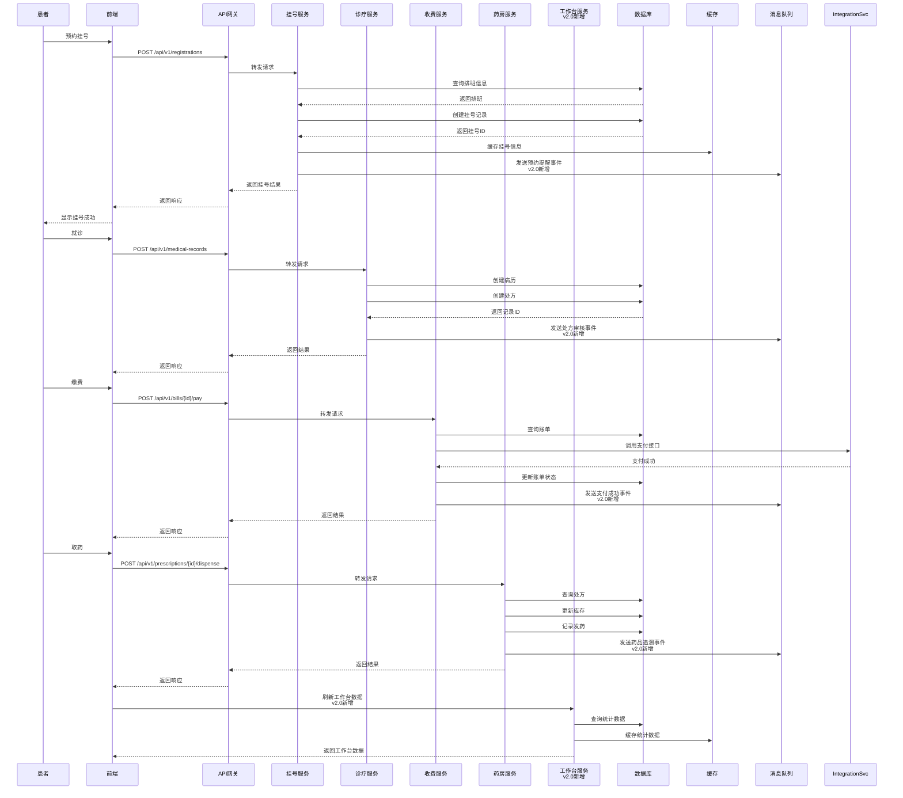

### 6.2 监管数据上报流程（v2.0新增）

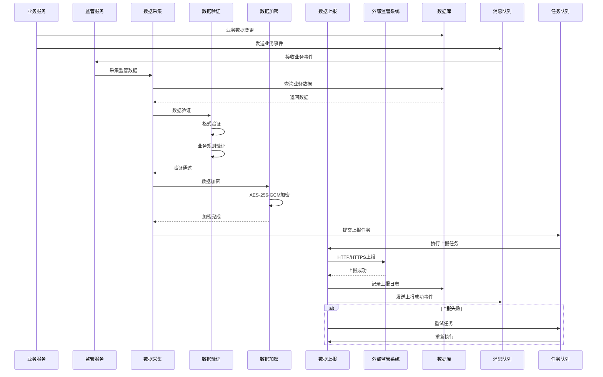

### 6.3 多租户数据隔离流程（保持v1.0）

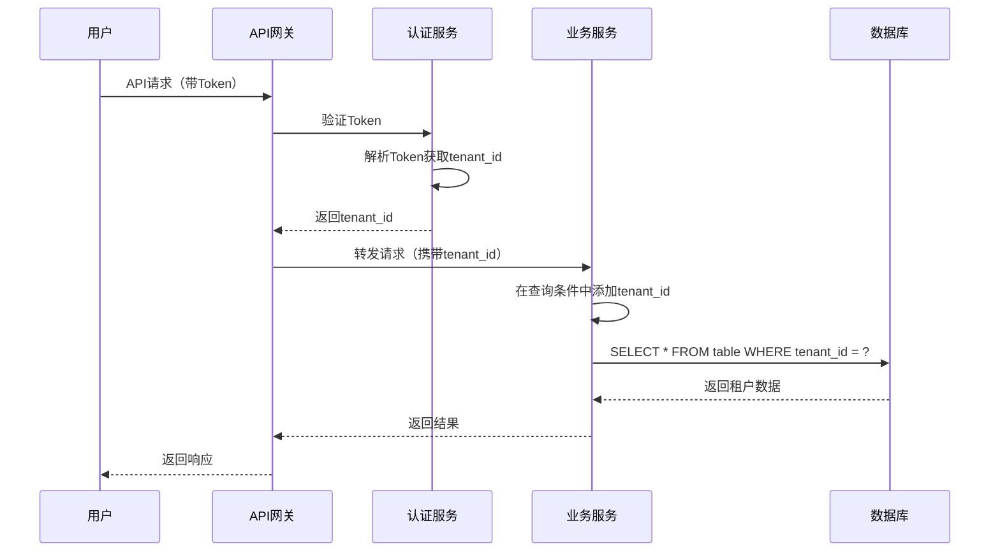

### 6.4 工作台数据实时刷新流程（v2.0新增）

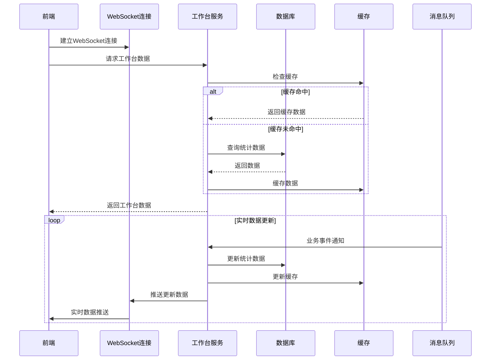

## 七、异常处理策略

### 7.1 异常分类

#### 7.1.1 业务异常（保持v1.0）
- **类型**: 业务规则违反、数据验证失败
- **处理**: 返回明确的错误信息，HTTP状态码400
- **示例**: 患者不存在、库存不足、余额不足、预约冲突

#### 7.1.2 系统异常（保持v1.0）
- **类型**: 系统错误、数据库错误、外部服务错误
- **处理**: 记录错误日志，返回通用错误信息，HTTP状态码500
- **示例**: 数据库连接失败、外部API调用失败、服务不可用

#### 7.1.3 认证授权异常（保持v1.0）
- **类型**: Token无效、权限不足
- **处理**: 返回认证/授权错误，HTTP状态码401/403
- **示例**: Token过期、无访问权限、租户不匹配

#### 7.1.4 限流异常（v2.0新增）
- **类型**: API请求频率超限
- **处理**: 返回限流错误，HTTP状态码429
- **示例**: 请求频率过高、并发请求过多

#### 7.1.5 监管异常（v2.0新增）
- **类型**: 监管数据上报失败、监管规则违反
- **处理**: 记录监管日志，返回监管错误，HTTP状态码400/500
- **示例**: 监管数据格式错误、监管系统连接失败、监管规则违反

### 7.2 异常处理流程（v2.0增强）

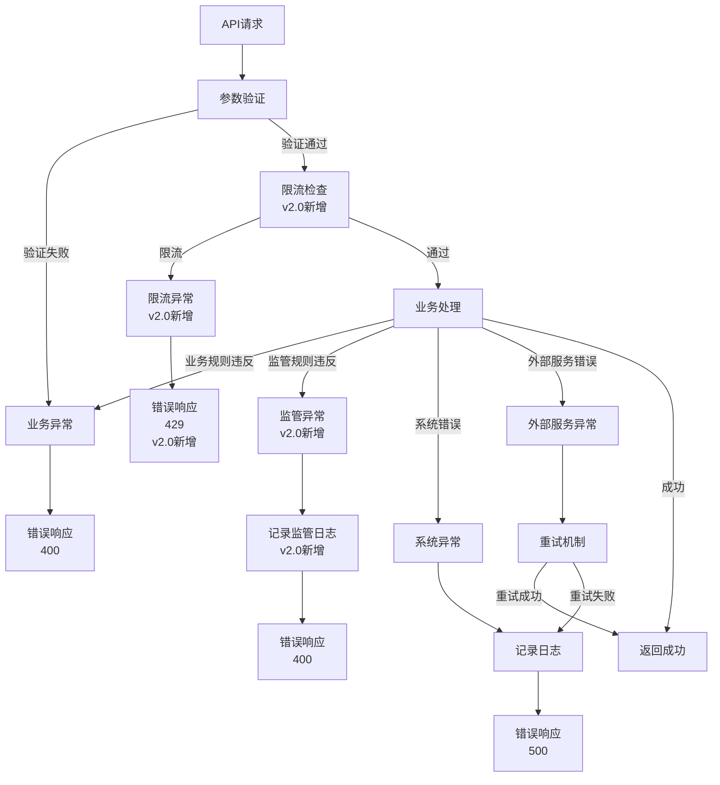

### 7.3 异常处理实现

#### 7.3.1 统一异常处理（v2.0增强）
```python
# 异常基类
class BaseException(Exception):
    code: int
    message: str
    details: dict = None

# 业务异常
class BusinessException(BaseException):
    code = 400
    message = "业务处理失败"

# 系统异常
class SystemException(BaseException):
    code = 500
    message = "系统错误"

# 限流异常（v2.0新增）
class RateLimitException(BaseException):
    code = 429
    message = "请求频率过高，请稍后重试"

# 监管异常（v2.0新增）
class RegulatoryException(BaseException):
    code = 400
    message = "监管规则违反"

# 全局异常处理器
@app.exception_handler(BaseException)
async def exception_handler(request, exc):
    # 记录异常日志
    logger.error(f"Exception: {exc.message}", exc_info=True)
    
    # 监管异常特殊处理（v2.0新增）
    if isinstance(exc, RegulatoryException):
        regulatory_logger.log(exc)
    
    return JSONResponse(
        status_code=exc.code,
        content={
            "code": exc.code,
            "message": exc.message,
            "details": exc.details,
            "timestamp": datetime.now().isoformat(),
            "request_id": request.state.request_id
        }
    )
```

#### 7.3.2 重试机制（v2.0增强）
- **外部服务调用**: 实现指数退避重试
- **数据库操作**: 连接池自动重连
- **消息队列**: 失败消息进入死信队列
- **监管数据上报**: v2.0新增，监管数据上报失败自动重试，支持手动补报

#### 7.3.3 降级策略（v2.0增强）
- **缓存降级**: 外部服务失败时使用缓存数据
- **功能降级**: 非核心功能失败不影响主流程
- **限流降级**: 高并发时限制请求速率
- **监管降级**: v2.0新增，监管系统不可用时，数据本地缓存，待系统恢复后补报

## 八、数据库设计原则

### 8.1 多租户设计（保持v1.0）
- **策略**: 行级隔离（Row-level Security）
- **实现**: 所有业务表包含`tenant_id`字段
- **索引**: `tenant_id` + 业务字段建立联合索引
- **v2.0增强**: 监管数据表也支持多租户隔离

### 8.2 表设计规范（保持v1.0）
- **命名**: 小写+下划线，如`patient_info`
- **主键**: 统一使用UUID或雪花算法ID
- **时间戳**: 统一包含`created_at`、`updated_at`
- **软删除**: 重要数据使用`deleted_at`软删除
- **v2.0增强**: 监管数据表包含`reported_at`、`report_status`字段

### 8.3 数据加密（v2.0增强）
- **敏感字段**: 使用AES-256-GCM加密存储
- **加密字段**: 姓名、身份证、电话等
- **查询优化**: 加密字段不支持模糊查询，需建立索引映射表
- **v2.0增强**: 
  - 监管数据敏感字段加密
  - 密钥轮换机制
  - 加密性能优化

### 8.4 数据备份（v2.0新增）
- **备份策略**: 定期全量备份 + 增量备份
- **备份频率**: 每日全量备份，每小时增量备份
- **备份存储**: 独立备份存储系统
- **备份加密**: 备份数据加密存储
- **恢复测试**: 定期恢复测试，确保备份可用

## 九、安全设计

### 9.1 传输安全（保持v1.0）
- **HTTPS**: 强制使用HTTPS
- **TLS版本**: TLS 1.3
- **证书管理**: 定期更新SSL证书

### 9.2 存储安全（v2.0增强）
- **数据加密**: 敏感数据AES-256-GCM加密
- **密码加密**: 使用bcrypt哈希
- **密钥管理**: 密钥存储在密钥管理服务（KMS）
- **v2.0增强**:
  - 密钥轮换机制
  - 监管数据加密存储
  - 备份数据加密

### 9.3 访问安全（v2.0增强）
- **认证**: JWT Token认证
- **授权**: RBAC细粒度权限控制
- **审计**: 完整操作日志记录
- **限流**: API限流防止暴力攻击
- **v2.0增强**:
  - 数据级权限控制
  - 监管数据访问权限
  - 操作审计增强

### 9.4 监管安全（v2.0新增）
- **数据上报安全**: 监管数据加密传输
- **访问控制**: 监管数据访问权限控制
- **审计追踪**: 监管操作完整审计
- **合规检查**: 定期合规性检查

## 十、性能优化策略

### 10.1 缓存策略（v2.0增强）
- **热点数据**: Redis缓存（患者信息、药品信息等）
- **查询结果缓存**: 复杂查询结果缓存
- **缓存更新**: 写时更新、定时刷新
- **缓存失效**: TTL过期、主动失效
- **v2.0增强**:
  - 工作台数据缓存
  - 搜索历史缓存
  - 监管数据缓存

### 10.2 数据库优化（v2.0增强）
- **索引优化**: 关键查询字段建立索引
- **查询优化**: 避免N+1查询，使用JOIN
- **分页优化**: 使用游标分页替代OFFSET
- **v2.0增强**:
  - 监管数据查询优化
  - 统计查询优化
  - 全文搜索索引

### 10.3 异步处理（v2.0增强）
- **耗时操作**: 报表生成、通知发送异步处理
- **消息队列**: 使用消息队列解耦服务
- **任务队列**: Celery处理后台任务
- **v2.0增强**:
  - 监管数据上报异步处理
  - 数据备份异步处理
  - 批量操作异步处理

### 10.4 API性能优化（v2.0新增）
- **API限流**: 防止接口滥用
- **响应压缩**: Gzip压缩响应数据
- **连接池**: 数据库连接池优化
- **批量接口**: 支持批量操作接口

## 十一、部署架构

### 11.1 容器化部署（保持v1.0）
- **Docker**: 每个微服务独立容器
- **Docker Compose**: 开发环境一键启动
- **Kubernetes**: 生产环境容器编排

### 11.2 服务发现（保持v1.0）
- **Consul/etcd**: 服务注册与发现
- **健康检查**: 定期健康检查，自动剔除故障服务
- **负载均衡**: Nginx/Kong实现负载均衡

### 11.3 监控告警（v2.0增强）
- **监控**: Prometheus + Grafana
- **日志**: ELK Stack
- **告警**: 异常自动告警通知
- **v2.0增强**:
  - 监管数据上报监控
  - 性能指标监控
  - 安全事件监控

### 11.4 备份恢复（v2.0新增）
- **备份系统**: 独立备份系统
- **备份策略**: 定期全量备份 + 增量备份
- **恢复测试**: 定期恢复测试
- **灾难恢复**: 灾难恢复预案

## 十二、设计原则总结

### 12.1 微服务原则（保持v1.0）
- **单一职责**: 每个服务职责单一
- **独立部署**: 服务可独立部署和扩展
- **服务通信**: RESTful API + 消息队列

### 12.2 多租户原则（保持v1.0）
- **数据隔离**: 严格的数据隔离
- **资源共享**: 基础设施共享，降低成本
- **配置隔离**: 每个租户独立配置

### 12.3 安全原则（v2.0增强）
- **最小权限**: 最小权限原则
- **纵深防御**: 多层安全防护
- **审计追踪**: 完整操作审计
- **v2.0增强**: 监管合规安全

### 12.4 性能原则（v2.0增强）
- **缓存优先**: 合理使用缓存
- **异步处理**: 耗时操作异步化
- **数据库优化**: 索引和查询优化
- **v2.0增强**: API限流、响应优化

### 12.5 监管合规原则（v2.0新增）
- **数据上报**: 及时准确的数据上报
- **违规监控**: 实时违规监控和预警
- **合规检查**: 定期合规性检查
- **审计追踪**: 监管操作完整审计

## 十三、下一步行动

### 13.1 已完成
- ✅ 整体架构设计
- ✅ 分层设计
- ✅ 核心组件设计（包含v2.0新增组件）
- ✅ 模块依赖关系（包含v2.0新增服务）
- ✅ 接口契约定义（包含v2.0新增接口）
- ✅ 数据流向图（包含v2.0新增流程）
- ✅ 异常处理策略（v2.0增强）
- ✅ 数据库设计原则
- ✅ 安全设计（v2.0增强）
- ✅ 性能优化策略（v2.0增强）
- ✅ 部署架构
- ✅ 设计原则总结

### 13.2 待完成
- ⏳ 进入Atomize阶段（任务拆分）
- ⏳ 生成 TASK_v2.0.md 文档
- ⏳ 详细数据库表结构设计（监管合规相关表）
- ⏳ 详细API接口文档（v2.0新增接口）

---

**文档版本**: v1.0  
**创建时间**: 2025-01-09  
**最后更新**: 2025-01-09  
**状态**: ✅ 已完成  
**下一步**: 进入原子化阶段（Atomize），生成 TASK_v2.0.md 文档