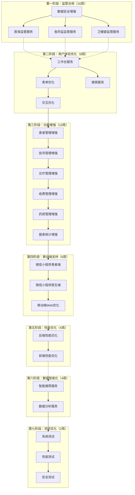

# TASK_v2.0 - 门诊诊所管理系统 v2.0 版本任务拆分

## 一、任务概览

本文档将v2.0版本拆分为原子任务，每个任务包含输入契约、输出契约、实现约束和依赖关系。

### 1.1 任务分类

v2.0版本任务按阶段分为以下类别：
- **TASK_V2_01_监管合规** - 医保、食药监、卫健委监管功能（16周）
- **TASK_V2_02_用户体验优化** - 工作台、表单、搜索、交互优化（8周）
- **TASK_V2_03_功能增强** - 各业务模块功能增强（10周）
- **TASK_V2_04_移动端支持** - 微信小程序、移动端Web优化（6周）
- **TASK_V2_05_性能优化** - 后端、前端性能优化（4周）
- **TASK_V2_06_数据智能化** - 智能推荐、数据分析（4周）
- **TASK_V2_07_测试优化** - 系统测试、性能测试、安全测试（2周）

### 1.2 任务依赖图

### 1.3 任务执行顺序

#### 阶段1：监管合规（16周，最高优先级）
1. TASK_V2_01_监管合规.md 中的所有任务

#### 阶段2：用户体验优化（8周，高优先级）
2. TASK_V2_02_用户体验优化.md 中的所有任务

#### 阶段3：功能增强（10周，高优先级）
3. TASK_V2_03_功能增强.md 中的所有任务

#### 阶段4：移动端支持（6周，中优先级）
4. TASK_V2_04_移动端支持.md 中的所有任务

#### 阶段5：性能优化（4周，中优先级，可与阶段4并行）
5. TASK_V2_05_性能优化.md 中的所有任务

#### 阶段6：数据智能化（4周，低优先级，可与阶段5并行）
6. TASK_V2_06_数据智能化.md 中的所有任务

#### 阶段7：测试和优化（2周，必须）
7. TASK_V2_07_测试优化.md 中的所有任务

## 二、任务状态跟踪

### 2.1 任务状态定义
- **pending**: 待开始
- **in_progress**: 进行中
- **completed**: 已完成
- **blocked**: 阻塞中
- **cancelled**: 已取消

### 2.2 任务清单汇总

各阶段详细任务请参考对应的子文档：
- [TASK_V2_01_监管合规.md](./TASK_V2_01_监管合规.md)
- [TASK_V2_02_用户体验优化.md](./TASK_V2_02_用户体验优化.md)
- [TASK_V2_03_功能增强.md](./TASK_V2_03_功能增强.md)
- [TASK_V2_04_移动端支持.md](./TASK_V2_04_移动端支持.md)
- [TASK_V2_05_性能优化.md](./TASK_V2_05_性能优化.md)
- [TASK_V2_06_数据智能化.md](./TASK_V2_06_数据智能化.md)
- [TASK_V2_07_测试优化.md](./TASK_V2_07_测试优化.md)

## 三、任务执行原则

### 3.1 执行顺序
- 严格按照依赖关系执行
- 同一阶段的任务可以并行执行（如果无依赖）
- 监管合规功能优先执行（最高优先级）
- 保持v1.0功能正常运行

### 3.2 质量要求
- 每个任务完成后必须通过验收标准
- 代码符合项目规范（PEP 8、ESLint）
- 单元测试覆盖率 > 80%
- 保持v1.0 API兼容性
- 数据库迁移使用Alembic

### 3.3 技术约束
- 后端：Python 3.11+、FastAPI（最新版本）
- 前端：原生HTML/JS + Bootstrap 5、Vite构建工具
- 数据库：PostgreSQL 15+、Redis 7+
- 保持v1.0架构模式（微服务、多租户）

## 四、关键里程碑

### 里程碑1：监管合规功能完成（第16周）
- ✅ 数据安全增强完成
- ✅ 医保监管服务完成
- ✅ 食药监监管服务完成
- ✅ 卫健委监管服务完成

### 里程碑2：用户体验和功能增强完成（第34周）
- ✅ 用户体验优化完成
- ✅ 功能增强完成
- ✅ 核心功能测试通过

### 里程碑3：移动端和性能优化完成（第40周）
- ✅ 微信小程序开发完成
- ✅ 移动端Web优化完成
- ✅ 性能优化完成

### 里程碑4：数据智能化完成（第44周）
- ✅ 智能推荐功能完成
- ✅ 数据分析功能完成

### 里程碑5：系统测试和发布准备（第46周）
- ✅ 系统测试完成
- ✅ 性能测试完成
- ✅ 安全测试完成
- ✅ 文档完成

---

**文档版本**: v1.0  
**创建时间**: 2025-01-09  
**最后更新**: 2025-01-09  
**状态**: ✅ 已完成  
**下一步**: 创建各阶段详细任务文档

